<div align="center">

# 🩺 Artifact Medical AI

**의료 영상 기반 AI 보조 진단 · 처방 지원 시스템**
*AI-assisted Clinical Workflow for Skin Lesion & Facial Skin Diagnosis Support*


> 2026년도 1학기 S.M.A.R.T. 토너먼트 최우수상 수상


> 2026 In-Jeju Challenge 사물인터넷 혁신융합대학사업단 최우수상 총장상 수상 
<br/>

[](https://github.com/CSID-DGU/2026-1-CECD1-5-Artifact-9/tags)


**🌐 [artifact-medical.site](https://artifact-medical.site)** — 로그인 화면의 「로그인 없이 데모 체험하기」로 가입 없이 전체 흐름을 둘러볼 수 있다

</div>


> ⚠️ **본 시스템은 의료진의 의사결정을 보조하는 prototype이며, 실제 의료 진단을 대체하지 않습니다.**
> AI는 단일 정답이 아니라 **Top-5 후보 질환**을 제시하고, 최종 진단·상병코드·처방 결정은 항상 의료진이 수행합니다.

---

## 📌 한 줄 소개

피부 사진을 올리면 AI 모델이 **Top-5 후보 질환 + 신뢰도(confidence) + GradCAM 설명 히트맵**을 제시하고, 의료진이 이를 참고해 **KCD 상병코드(주/부상병)** 와 **처방 약품**을 골라 진료를 마칠 수 있도록 돕는 **진료 워크플로우 지원 시스템**이다.
점·피부 병변 8종과 얼굴 피부질환 6종을 보는 **두 개의 AI 모델**이 있고, 환자는 진료 전에 대기실에서 **접수증 QR로 자기 휴대폰을 키오스크 삼아 예비분석**을 받는다. 처방 코멘트와 증명서 초안은 **LLM(Gemini → Claude)** 이 거들고, 발급한 서류는 감열지 발급확인증의 QR로 진위를 확인할 수 있다.

## 🎯 프로젝트 목적

기존의 피부 병변 AI 서비스 다수는 "AI가 진단명을 알려주는 것"에 초점을 맞추지만, 실제 임상 현장에서는 **로그인 → 접수 → 대기 → 진료 → AI 분석 → 진단 확정 → 처방 → 완료 → 서류 발급 → 이력 관리**로 이어지는 워크플로우 전체가 중요하다.

본 프로젝트는 EMR 솔루션 전문 기업 **비트컴퓨터(Bitcomputer)** 와의 산학 협력을 바탕으로, AI 분석 결과를 **진료 워크플로우 안에 자연스럽게 녹여낸** closed-loop clinical assistant를 지향한다. 핵심 설계 원칙은 다음과 같다.

- **AI는 보조 도구다 (AI as assistive, not autonomous).** 단일 정답 대신 Top-K 후보 + 설명 히트맵을 제시하고, 신뢰도가 낮으면 숨기지 않고 "확신 낮음" 경고를 붙인다.
- **AI 예측과 의료진 확정 진단은 구조적으로 분리한다.** `analysis_result`(AI 출력)와 `prescription`(의료진 결정)은 별도 테이블이며, AI 분석 없이도 처방을 작성할 수 있다(`analysis_id` nullable).
- **대기 시간을 진료 준비로 바꾼다.** 대기실 키오스크 예비분석은 진료 상태머신과 분리된 사이드 채널(`preliminary_analysis`)로 진료실에 전달된다 — 예비분석이 진료 기록을 바꾸지 않는다.
- **진료 상태는 8단계 상태머신으로 엄격히 관리한다.** 잘못된 순서의 호출은 도메인 단에서 `IllegalStateException`으로 거부된다.
- **모든 처방 · 서류는 작성자(의료진)에 귀속된다.** 처방 시점의 `member_id` + `member_name`, 발급 시점의 의사 성명 · 면허번호 · 문서 전체를 스냅샷으로 남긴다.
- **화면 · API · AI 를 나눠 배포한다.** 화면은 CloudFront, API 는 ALB 뒤 EC2, AI 는 내부 ALB 뒤 오토스케일링 그룹 — 한쪽이 바빠도 다른 쪽이 덜 느려지고, AI 는 부하에 따라 늘고 준다.

---

## 🆕 v2.0.0 — 1학기(v1.0.0) 이후 달라진 점

| 영역 | 변경 |
| --- | --- |
| **AI** | 얼굴 피부질환 모델 추가(6종 · 384 입력 · 홀드아웃 92.3%) · 피부 병변 8종(염증성 추가) · LayerCAM 히트맵 통일 + 확대 히트맵 · 확신이 낮을 때 확대 영역으로 재판정 · "확신 낮음" 경고 |
| **대기실 키오스크** | 접수증 QR → 환자 휴대폰에서 본인 확인 · 촬영 대상(얼굴 / 점·병변) 선택 · 인쇄물 사진 자동 자르기 · 예비분석 + 참고 소견 → 진료실 "대기 중 예비 분석결과" 카드 |
| **접수 · 진료** | 접수번호(`V00056` · `56`)로 바로 찾기 · 진료를 시작했어도 처방 전이면 접수취소 · 진료 삭제 · 신규 환자 기본 연락처 |
| **증명서** | 처방전 · 진단서 · 진료확인서 · 소견서 · 진료의뢰서 **실제 발급** · AI 초안 · 발급대장 스냅샷 · 재발급 / 무효 · 감열지 발급확인증 QR(생년월일 확인) |
| **출력 · 알림** | 감열지 프린터 에이전트(`print-agent/` — 접수증 · 진료요약서 · 발급확인증) · 텔레그램 접수 알림(선택) |
| **LLM** | Gemini 과부하 · 한도 초과 · 타임아웃이면 대체 Gemini 모델 → Claude 로 넘기는 대체 체인 · 요청별 시간 예산 · 잘린 응답 · JSON 검증 |
| **화면** | 대기실 진료 대기 현황판(`/waiting`) · 로그인 없이 데모 체험(탭 안의 가상 서버) · 직책별 화면 권한 |
| **인프라** | Flyway 마이그레이션 · GitHub Actions CI · 화면 S3 + CloudFront · API 공개 ALB · AI 내부 ALB + 오토스케일링 · GitHub OIDC 무(無)키 배포 · 도메인 `artifact-medical.site` |

---

## 🖼️ Demo / Screenshots

> 아래 화면은 데모 모드(가상 환자 데이터)로 찍은 최신 화면이다. 운영 화면과 같은 코드다.

### 0) 로그인 / 회원가입 / 데모 체험 — `/`

직책(의사/간호사/일반)을 선택해 회원가입하거나 기존 계정으로 로그인한다. 인증 후 JWT 토큰이 `localStorage`에 저장되고, 직책에 따라 열 수 있는 화면이 정해진다(접수 · 조회 · 증명은 일반 이상, 진료는 간호사 이상, 진단 확정 · 처방 · 서술형 서류는 의사). 「로그인 없이 데모 체험하기」를 누르면 이 탭 안의 가상 서버로 전 과정을 둘러본다 — 실제 서버와 환자 기록에는 아무것도 가지 않는다.

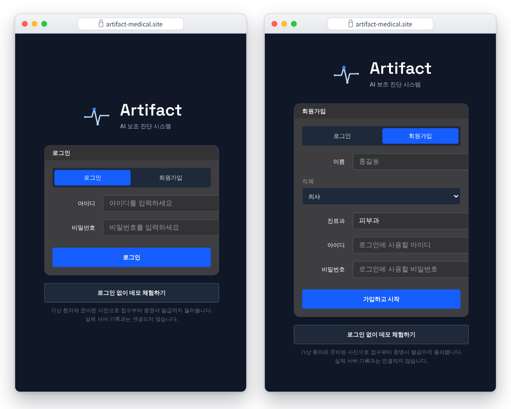

### 1) 접수 — `/main`

환자 정보를 등록하면 동시에 내원(Visit)이 생성되고, 진료대기/진료완료 현황이 한눈에 표시된다. 접수하면 **키오스크 QR**이 담긴 접수증을 바로 출력할 수 있다(감열지 프린터 · 텔레그램 알림 선택).

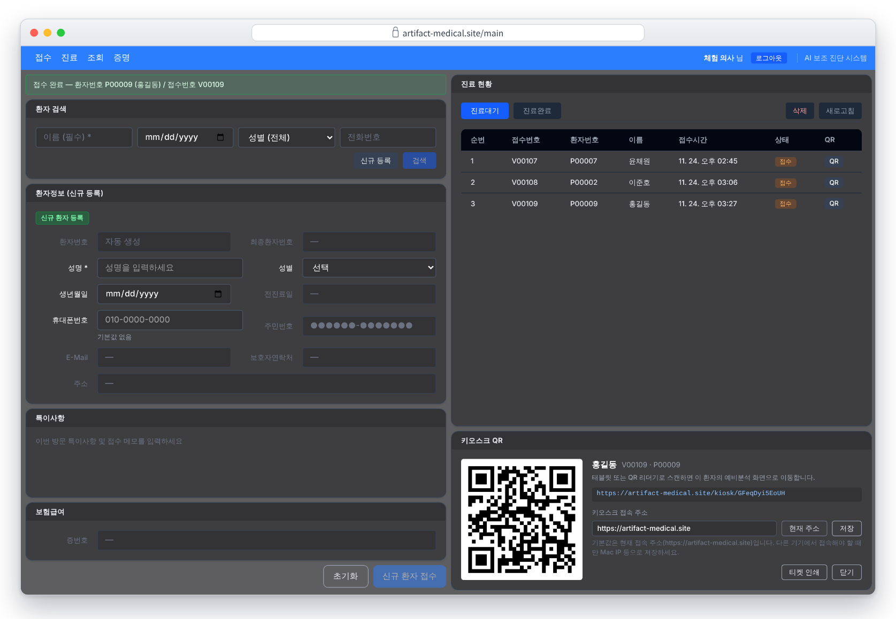

### 2) 대기실 키오스크 — 환자 휴대폰 `/kiosk/{token}`

환자가 접수증 QR을 찍으면 로그인 없이 자기 휴대폰에서 본인 확인 → 촬영 대상(얼굴 피부 / 점·피부 병변) 선택 → 사진 촬영 순서로 **예비분석**을 받는다. 인쇄물을 찍으면 사진 부분만 자동으로 잘라 내고, 분석 영역은 손으로 맞출 수 있다. 결과(Top-5 · 히트맵 · 참고 소견)는 진료실의 **"대기 중 예비 분석결과"** 카드로 그대로 넘어간다.

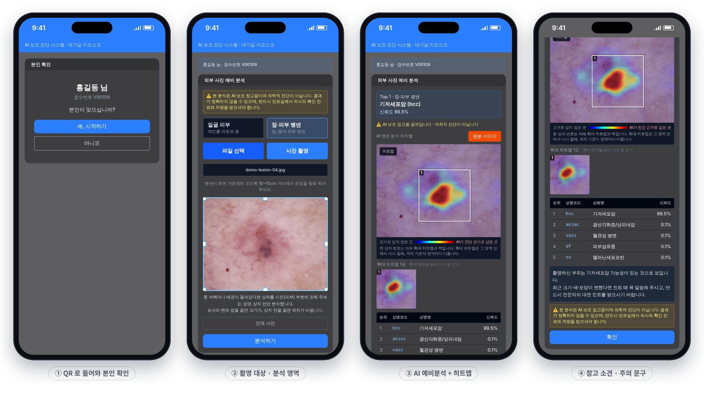

### 3) 진료 · AI 분석 · 처방 — `/main/clinic`

접수된 환자를 선택해 진료를 시작하고, 피부 사진을 업로드한 뒤 AI 분석을 요청한다. Top-5 후보와 **GradCAM 히트맵**이 함께 표시되며, 키오스크 예비분석 결과도 왼쪽에 함께 보인다. 의료진은 결과를 참고해 KCD 상병(주/부상병)과 약품 처방을 입력하고, 처방 작성 직전 **AI 처방 코멘트(2줄)** 를 받아 작성을 보조받는다.

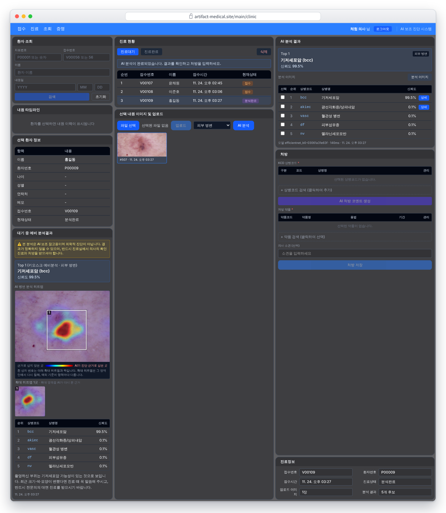

### 4) AI 분석 결과 + GradCAM 설명 히트맵

Top-1 질환명, Top-5 후보, confidence, inference time, model version과 함께 **GradCAM 오버레이 이미지**가 반환된다. Top-1 신뢰도가 임계값(`LOW_CONFIDENCE_THRESHOLD`, 기본 0.45) 미만이면 결과에 **"확신 낮음" 경고**가 함께 붙는다 — 결과를 막지는 않는다. 홀드아웃 2,857장 기준 약 14%에 경고가 붙고, 그 14% 안에 전체 오답의 38%가 들어 있다.

히트맵은 한 가지 색띠로 칠한다 — 빨강은 AI가 진단 근거로 삼은 곳, 파랑은 근거로 삼지 않은 곳이다. 히트맵 보기에서는 전체 이미지 위에 히트맵이 짚은 곳(최대 3곳)을 번호 상자로 표시하고, 그 영역을 확대한 **확대 히트맵**을 나란히 보여 준다. 피부 병변 분석에서 원본만으로 신뢰도가 경고선 미만이면 확대 영역들의 판정을 함께 보고 **다시 판정**하며, 원본 사진만 본 답도 함께 표시한다(확신 낮음 경고는 그대로 남고, 원본이 악성·전암을 짚었다면 재판정 뒤에도 그 경고 문구를 유지한다).

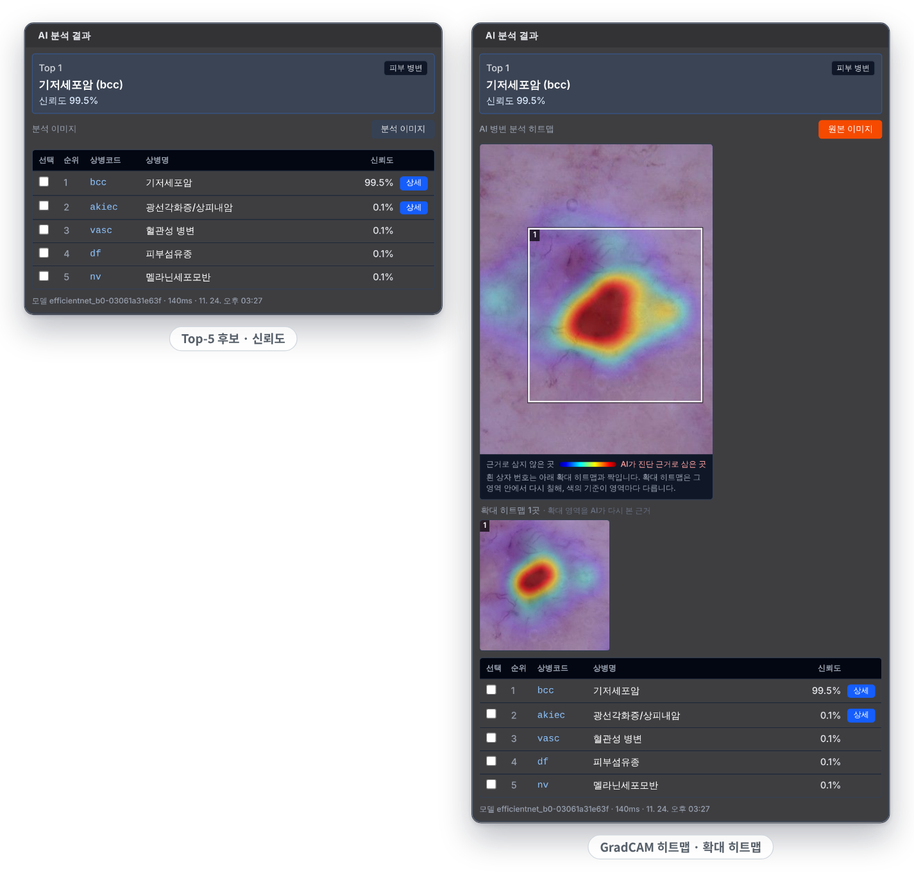

### 5) KCD / 약품 검색

검색 모달에서 KCD 상병코드와 약품/처방코드를 **코드 또는 한글명**으로 검색하여 선택한다. 마스터 데이터는 Spring Boot 기동 시 Excel 파일에서 자동 적재된다 (**KCD 약 2.4만 건, 약품/처방코드 약 49.6만 건 규모**).

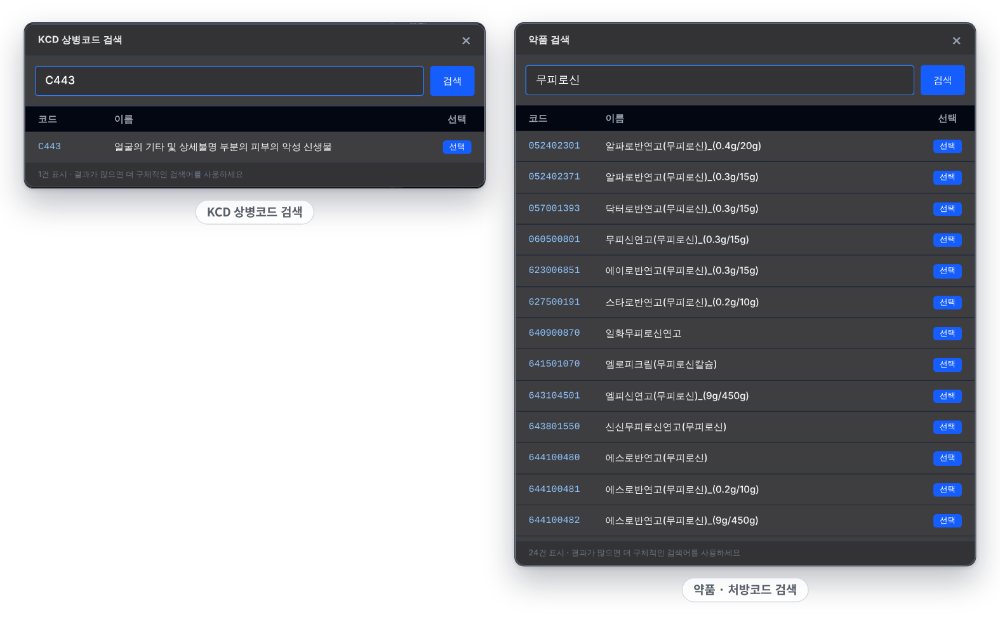

### 6) LLM AI 처방 코멘트

주상병/부상병/접수 메모를 바탕으로 LLM이 **추천 처방 방향 1줄 + 환자 주의사항 1줄**, 정확히 2줄의 코멘트를 생성해 처방 카드에 노출한다. Gemini가 과부하·한도 초과·타임아웃이면 대체 모델 → Claude 순으로 넘어가 답을 받고, 모두 실패해도 사용자 친화적 메시지를 반환한다.

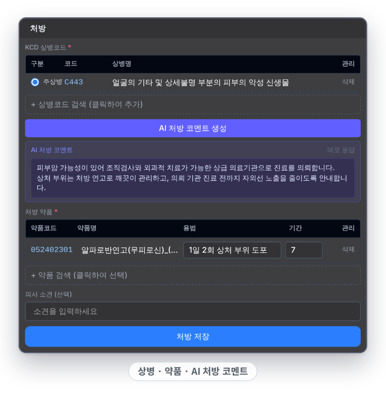

### 7) 환자 / 내원 이력 조회 — `/main/lookup`

차트번호, 이름, 내원일 조건을 조합해 환자를 검색한다. 환자별 내원 타임라인과 분석 이미지, AI 분석 결과, 처방 상세를 한 화면에서 확인한다.

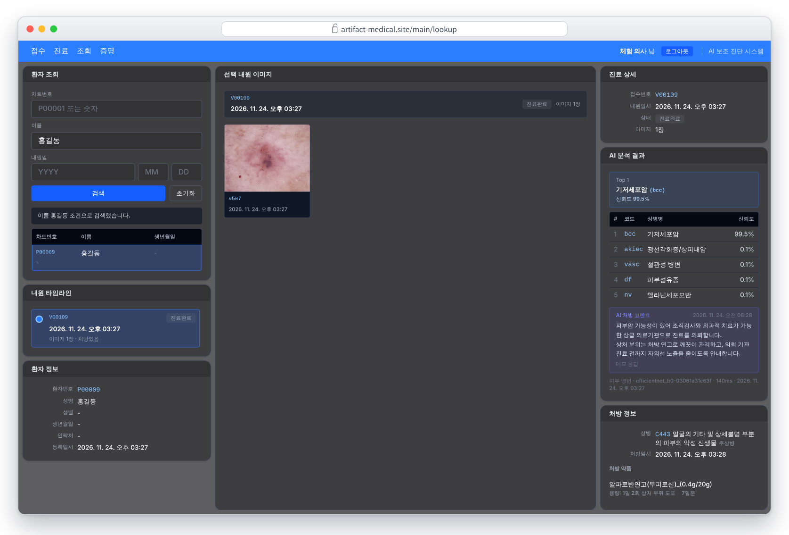

### 8) 증명서 발급 — `/main/certificate`

접수번호나 이름으로 내원을 찾아 **처방전 · 진단서 · 진료확인서 · 소견서 · 진료의뢰서**를 발급한다. 법정 서식의 필수 항목(병명 · 향후 치료 소견 등)은 **AI 초안**으로 채운 뒤 의사가 검토·수정해 발급하고, 발급 시점의 문서 전체를 발급대장에 스냅샷으로 남긴다(재발급 · 무효 처리). 감열지 발급확인증의 QR(`/d/c/{token}`)로 환자가 생년월일을 넣어 문서를 다시 볼 수 있다.

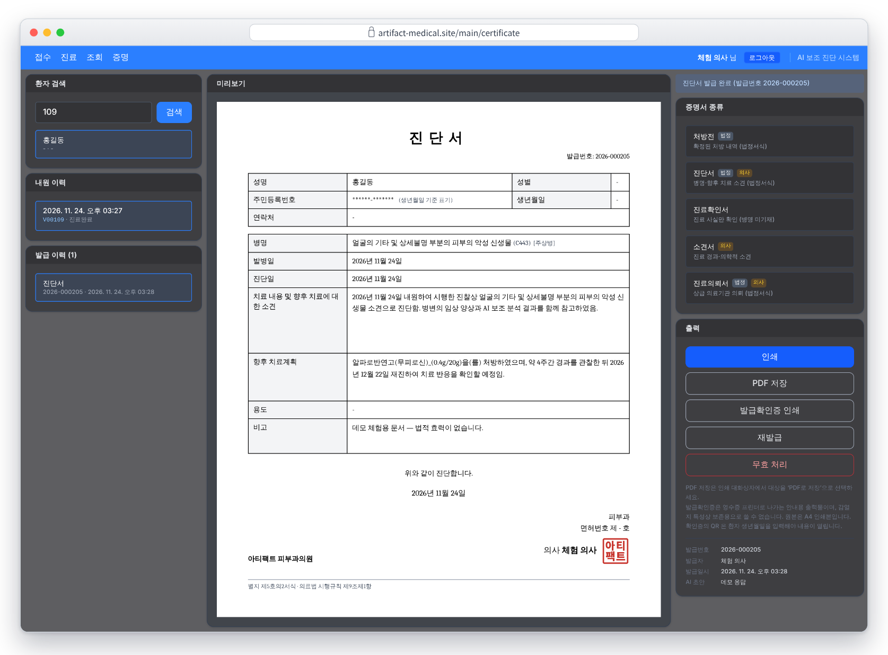

### 9) 진료 대기 현황판 — `/waiting`

대기실(로비) 모니터에 띄우는 화면이다. 대기번호와 이름 일부(`윤*원`)만 보여 주고, 진료실 호출이 바뀌면 화면이 알려 준다.

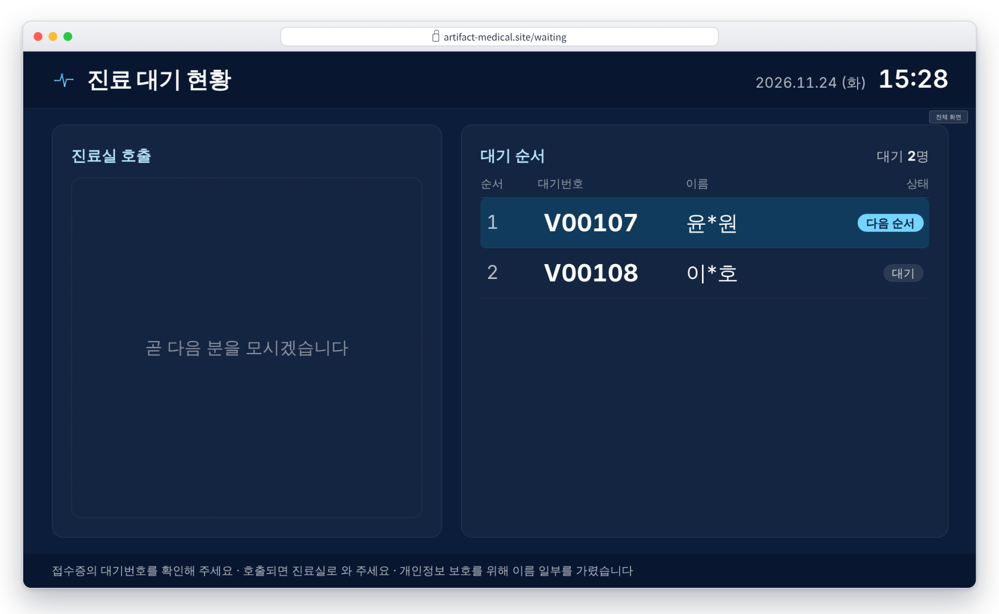

---

## ✨ 핵심 기능

### JWT 기반 인증 · 직책별 권한

- BCrypt로 해시된 비밀번호로 회원가입/로그인하고, 발급된 JWT를 모든 API 호출에 `Authorization: Bearer …` 헤더로 첨부한다.
- 역할(`MemberRole`): `DOCTOR`, `NURSE`, `STAFF`, `ADMIN` — 화면은 `frontend/src/auth/roles.ts` 한 곳에서 안내하고, 실제 차단은 서버의 `@StaffAccess` · `@MedicalAccess` · `@DoctorAccess`(`@PreAuthorize`)가 한다. 진단 확정 · 처방 · AI 처방 코멘트 · 서술형 서류(진단서 · 소견서 · 진료의뢰서) · 서류 무효는 의사만 한다.
- Spring Security + 커스텀 `JwtFilter`로 stateless 인증을 구성한다. 화면과 API의 출처가 다른 배포를 위해 CORS preflight를 보안 필터 앞에서 처리한다.
- 회원가입으로 지정할 수 있는 역할은 `DOCTOR` / `NURSE` / `STAFF` 뿐이다. 가입 API는 인증 없이 호출할 수 있으므로 `ADMIN` 자가 등록은 서버에서 차단한다.
- JWT 서명키(`JWT_SECRET`)와 백엔드↔AI 서버 공유 비밀(`INTERNAL_API_SECRET`)은 기본값이 없다. 설정하지 않으면 서버가 기동되지 않는다.

### AI 분석 — 모델 두 개 + GradCAM 설명 히트맵

| 태스크 | 대상 | 클래스 | 입력 | 특징 |
| --- | --- | --- | --- | --- |
| `skin_lesion` (기본) | 점 · 피부 병변 | 8종 | 224 | 확대 영역 재판정 사용 |
| `facial` | 얼굴 피부 | 6종(정상 피부 포함) | 384 | 원본 · 좌우 반전 평균(flip TTA) |

업로드 이미지를 EfficientNet-B0 모델로 분석하여 **Top-1 / Top-5 후보 질환 + confidence + inference time + model version** 을 반환한다. 동시에 **GradCAM 오버레이 이미지(JPEG)** 를 함께 생성·저장해 의료진이 "AI가 어디를 보고 판단했는지"를 시각적으로 확인할 수 있다. GradCAM은 cv2/grad-cam 라이브러리 의존 없이 **순수 PyTorch + Pillow** 로 구현되어 컨테이너 이미지가 가볍다. 히트맵은 `blocks.4` LayerCAM 을 좌우 반전과 평균해 뽑고, 확대 히트맵(최대 3장)과 낮은 신뢰도일 때의 확대 재판정 결과를 함께 돌려준다 — 방식을 고른 측정(ISIC 정답 마스크 1,100장 병변 적중 91.5%, 공식 홀드아웃 재판정 효과)은 `fastapi/tests/baselines/README.md` ③ 에 있다.

### 대기실 키오스크 예비분석

1. 접수하면 내원마다 **키오스크 토큰**이 발급되고, 접수증에 그 QR이 인쇄된다(만료일이 있다).
2. 환자가 휴대폰으로 QR을 찍으면 로그인 없이 `/kiosk/{token}` 에서 본인 확인 → 촬영 대상 선택 → 촬영 · 업로드를 한다. 인쇄물 사진은 사진 부분만 자동으로 잘라 낸다.
3. 백엔드가 AI 서버에 분석을 맡기고, LLM이 환자용 **참고 소견**을 붙인다(진단이 아님을 함께 고지).
4. 결과는 `preliminary_analysis`(내원 1:1)에 저장되어 진료실의 **"대기 중 예비 분석결과"** 카드로 보인다. 진료 상태머신은 건드리지 않는다.

### 증명서 발급 · 문서 공유

- 서류 5종: 처방전(의료법 시행규칙 제12조) · 진단서(제9조제1항) · 진료확인서 · 소견서(의료법 제17조) · 진료의뢰서.
- `POST /visits/{visitId}/certificates/draft` 로 **AI 초안**을 받고, 의사가 검토 · 수정해 발급한다(`ai_draft` 원문과 `ai_edited` 여부를 함께 남긴다).
- 발급대장(`certificate`)은 발급 시점의 문서 필드 전체(`content_json`), 의사 성명 · 면허번호 스냅샷, 발급번호(`2026-000042`)를 보존한다. 재발급은 원본을 가리키고(`reissue_of`), 무효는 사유와 시각을 남긴다.
- 감열지 발급확인증 · 진료요약서의 QR(`/d/c/{token}` · `/d/v/{token}`)은 문서 한 건만 여는 추측 불가 토큰이며, 증명서는 생년월일을 확인한 뒤에 보여 준다.

### 감열지 출력 · 알림

- `print-agent/` — 접수 데스크의 감열지 프린터(80mm, ESC/POS)로 **접수증 · 진료요약서 · 발급확인증**을 뽑는 로컬 에이전트. 원격 서버에서는 백엔드가 출력 작업을 쌓고(`PRINT_MODE=queue`), 에이전트가 `/api/v1/print/jobs/next` 를 가져가 출력한다.
- 텔레그램 접수 알림(선택) — 접수되면 팀 채팅방에 알린다(`TELEGRAM_*`).

### LLM 처방 코멘트 · 증명서 초안 · 키오스크 소견

처방 작성 직전 `POST /api/v1/visits/{visitId}/prescription/comment` 호출 시, 백엔드가 **주상병/부상병/접수 메모**와 **DB의 피부 치료 약품 풀(연고·크림 10개)** 을 프롬프트로 조합해 LLM 에 요청한다. 응답은 **정확히 2줄** 로 파싱된다(약품명+코드 포함 처방 방향, 환자 주의사항). 증명서 AI 초안과 키오스크 참고 소견도 같은 입구(`LlmGateway`)를 쓴다. Gemini 1차 모델이 과부하(503)·한도 초과(429)·타임아웃이면 **다른 Gemini 모델 → Claude** 순으로 넘어가 답을 받는다.

### 로그인 없이 데모 체험

로그인 화면의 「로그인 없이 데모 체험하기」는 화면은 운영과 똑같이 쓰고 `/api` 요청만 **이 탭 안의 가짜 백엔드**(`frontend/src/demo/`)가 받는다. 가상 환자 · 예시 사진 20장으로 접수 → 키오스크 → 진료 → 조회 → 증명서 → 현황판 7단계를 안내 패널을 따라 체험한다. 데이터는 `sessionStorage`에만 있어 탭을 닫으면 사라지고, 같은 브라우저의 실제 로그인은 건드리지 않는다.

### 8-state Visit State Machine

진료 진행은 도메인 엔티티(`Visit`)에 캡슐화된 상태머신으로 관리된다. 잘못된 순서의 호출은 `IllegalStateException`으로 거부된다. 진료를 시작한 접수도 처방 전이면 접수취소할 수 있다.

```
RECEIVED ─▶ IN_PROGRESS ─▶ ANALYZING ─▶ ANALYZED ─▶ DIAGNOSED ─▶ PRESCRIBED ─▶ COMPLETED
                                ▲           │
                                └─rollback──┘  (잘못된 이미지 → IN_PROGRESS 복구)

            (처방 전 어느 단계에서도 CANCELLED 가능)
```

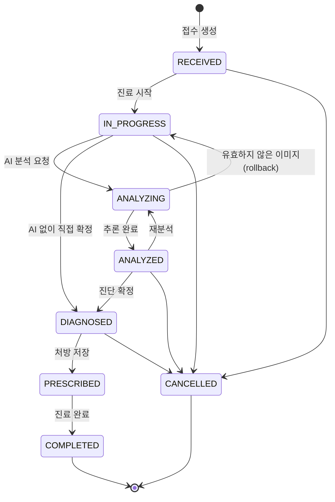

### 진료 워크플로우

| 영역 | 기능 |
| --- | --- |
| 인증 | 회원가입(직책 선택), 로그인, JWT 발급, 직책별 화면 · API 권한, 데모 체험 |
| 접수 | 환자 등록(이름·성별·생년월일·연락처·메모), Visit 자동 생성, 진료대기/완료 목록, 접수증 · 키오스크 QR 출력, 접수취소 |
| 키오스크 | QR 본인 확인, 촬영 대상 선택, 인쇄물 자동 자르기, 예비분석 + 히트맵 + 참고 소견 |
| 진료 | 접수번호 검색, 진료 시작, 이미지 업로드/선택, AI 분석 + GradCAM · 확대 히트맵, **주/부상병 다중 등록**, 약품 다중 처방, AI 코멘트, 처방 저장, 진료 완료 |
| 조회 | **차트번호/이름/내원일 조합 검색**, 환자별 내원 타임라인, 분석 결과, 처방 상세 |
| 의사별 조회 | `doctorId + from~to` 기간으로 의사별 환자 처방 이력 조회 |
| 증명서 | 서류 5종 발급, AI 초안, 발급대장 · 재발급 · 무효, 발급확인증 QR |
| 현황판 | 대기실 모니터용 진료 대기 · 호출 현황 |

### KCD 상병코드 / 약품코드 검색

- KCD 상병코드: **약 50,941행 / 고유 24,328건** (`상병코드`, `상병명`, `상병명 영문`)
- 처방(약품) 코드: **약 505,968행 / 고유 496,148건** (`처방코드`, `처방명`, `처방명 영문`)
- 검색은 코드 contains + 한글명 contains로 페이징하여 반환된다.

---

## 🔄 사용자 워크플로우

1. **로그인** 화면에서 직책을 선택해 회원가입하거나 로그인한다(또는 데모 체험).
2. **접수** 화면에서 환자 정보를 등록한다 → 동시에 Visit(`RECEIVED`)이 생성되고 키오스크 QR이 담긴 접수증이 나온다.
3. (대기실) 환자가 **접수증 QR**을 휴대폰으로 찍어 예비분석을 받는다 → 결과가 진료실로 넘어간다.
4. **진료** 화면에서 접수된 환자를 선택하고 진료를 시작한다(`RECEIVED → IN_PROGRESS`).
5. 피부 사진을 업로드하고 분석 대상(피부 병변 / 얼굴)을 골라 AI 분석을 요청한다(`IN_PROGRESS → ANALYZING`).
6. Spring Boot 백엔드가 이미지를 base64로 인코딩해 FastAPI `/predict-base64` 를 호출한다(공유 비밀 헤더).
7. FastAPI가 EfficientNet-B0로 분류 + GradCAM · 확대 히트맵을 생성한다.
8. Top-1 / Top-5 후보 + 히트맵이 저장된다(`ANALYZING → ANALYZED`).
9. 의료진이 결과를 참고해 KCD **주상병**(필수) + **부상병**(선택)을 검색·확정한다(`ANALYZED → DIAGNOSED`).
10. 약품/처방코드를 검색해 다중 약품 처방(용법·기간·주의사항)을 입력하고, (옵션) **AI 처방 코멘트** 로 작성을 보조받는다.
11. 처방을 저장한다(`DIAGNOSED → PRESCRIBED`) → 진료를 완료한다(`PRESCRIBED → COMPLETED`).
12. **조회** 화면에서 환자별 내원·분석·처방 이력을 확인한다.
13. **증명** 화면에서 AI 초안을 검토해 서류를 발급하고, 발급확인증을 출력한다.

---

## 🏗️ 시스템 아키텍처

### 배포 구조 (AWS)

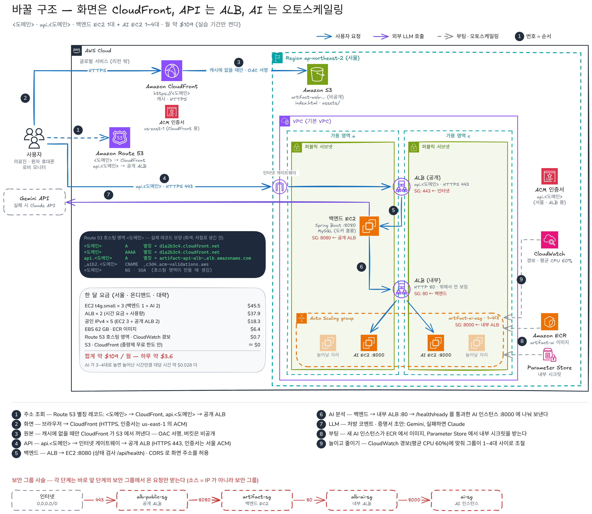

| 구분 | 어디서 | 주소 |
| --- | --- | --- |
| 화면(React) | **S3**(비공개, OAC) + **CloudFront** · 인증서 ACM(us-east-1) | `https://artifact-medical.site` |
| API(Spring Boot + MySQL) | **공개 ALB**(HTTPS 443, ACM 서울) → 백엔드 EC2 `t4g.small` :8080 | `https://api.artifact-medical.site` |
| AI(FastAPI) | 백엔드 → **내부 ALB**(:80) → **EC2 Auto Scaling 그룹** 1~4대 :8000 · 평균 CPU 60% 대상 추적 | 인터넷에서 안 보임 |
| 부팅 · 운영 | ECR(AI 이미지) · Systems Manager Parameter Store(내부 시크릿) · CloudWatch 경보 · Route 53 별칭 레코드 | — |

- 요청이 지나가는 보안 그룹은 **바로 앞 단계의 보안 그룹에서 온 요청만** 받는다 — 인터넷 →443→ 공개 ALB →8080→ 백엔드 →80→ 내부 ALB →8000→ AI.
- 상태 검사: 백엔드 `GET /api/health`, AI `GET /health/ready`(모델이 전부 로드돼야 200) — 깨진 AI 이미지는 트래픽을 받지 못한다.
- 콘솔에서 직접 만드는 실습 절차는 [`docs/aws-elb-asg-guide.md`](docs/aws-elb-asg-guide.md), 그림 원본(`.excalidraw`)과 상황별 시나리오(비용 최소 · 백엔드 확장 · AI 요청 폭주 · 보안 강화)는 [`docs/architecture/`](docs/architecture/)에 있다.
- 한 서버(EC2 한 대 + Docker Compose + Caddy)로 돌리는 구성도 그대로 지원한다 — 저장소 변수 `DEPLOY_TARGET` 하나로 고른다.

### 배포 흐름 (CI/CD)

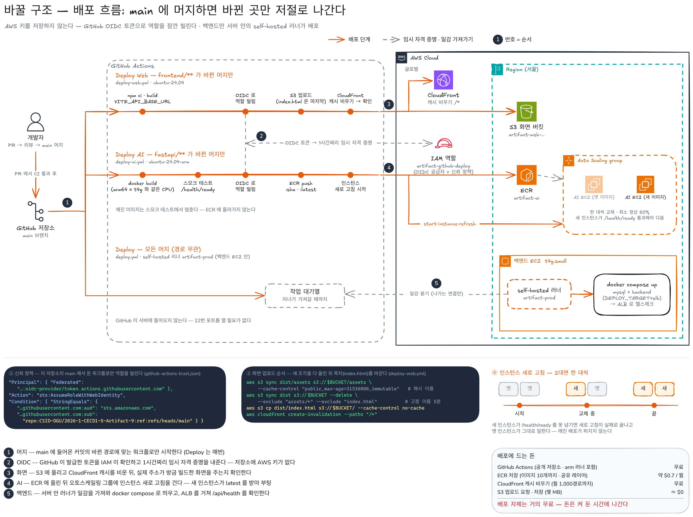

| 워크플로 | 언제 | 하는 일 |
| --- | --- | --- |
| `ci.yml` | PR · push | 백엔드 테스트 · 프론트 린트/빌드 · FastAPI 이미지 빌드 · 기동(arm64) |
| `deploy-web.yml` | `frontend/**` 변경 | 빌드(`VITE_API_BASE_URL`) → S3 업로드(해시 파일 1년 캐시, `index.html` 은 마지막) → CloudFront 캐시 비우기 → 실제 주소 확인 |
| `deploy-ai.yml` | `fastapi/**` 변경 | arm64 이미지 빌드 → `/health/ready` 스모크 테스트 → ECR push → 오토스케일링 **인스턴스 새로 고침**(한 대씩 교체) |
| `deploy.yml` | 모든 머지 | 백엔드 EC2 안의 self-hosted 러너가 일감을 가져와 Docker Compose 로 배포 → ALB 를 거쳐 헬스체크 |

AWS 키는 저장소에 없다 — GitHub OIDC 토큰으로 IAM 역할(main 브랜치만)을 빌려 1시간짜리 임시 자격 증명을 쓴다.

### 애플리케이션 구성

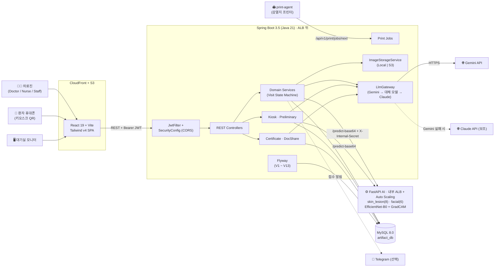

**핵심 흐름**

- 모든 비-인증 API는 `JwtFilter`를 통과한 뒤에야 컨트롤러에 도달한다. 공개 경로는 로그인 · 회원가입, `/api/health`, Swagger, 키오스크 세션(`/api/kiosk/**`, 토큰으로 한 건만), 공개 문서(`/api/public/documents/**`, 토큰 + 생년월일)뿐이다. 환자 이미지 · 히트맵은 번호가 순차라 공개하지 않고, 화면이 토큰을 실어 받아 온다.
- 이미지 업로드는 `ImageStorageService` 인터페이스(Local / S3 구현 전환 가능)를 통과한다. 도커 기본은 `local`이고, S3 를 쓰면 EC2 인스턴스 역할로 키 없이 접근한다.
- AI 분석은 백엔드 → FastAPI base64 호출로 일원화되어 있어 모델 서버를 늘리거나 GPU 인스턴스로 옮기기 쉽다. FastAPI는 공유 비밀(`INTERNAL_API_SECRET`) 없는 요청을 거절한다.
- LLM(Gemini·Claude) 호출은 백엔드에서만 발생한다 — 프론트는 API 키를 알지 못한다.

### 구성별 비용 (서울 리전 · 온디맨드 · 대략)

| 구성 | 월 요금 | 한 줄 평 |
| --- | ---: | --- |
| EC2 한 대 (Docker Compose) | 약 $22 | 가장 싸지만 한 대가 멈추면 전부 멈춘다 |
| 화면만 CloudFront + 서버 한 대 | 약 $22 | 같은 값에 화면이 CDN 으로 빨라진다 |
| **ALB 2 + AI 오토스케일링 (위 그림)** | **약 $109** | AI 가 부하에 따라 늘고 준다 · 한 대씩 무중단 배포 |
| + 백엔드 여러 대 + RDS Multi-AZ | 약 $172 | 백엔드 · DB 까지 다중 AZ |

항목별 내역과 장단점은 [`docs/architecture/08-cost-comparison.png`](docs/architecture/08-cost-comparison.png) · [`artifact-architecture-cost.pdf`](docs/architecture/artifact-architecture-cost.pdf)에 있다.

---

## 🔁 데이터 흐름 (DFD / Clinical Workflow)

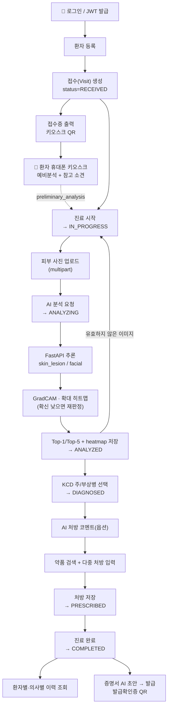

---

## 🗄️ ERD / DB 설계 요약

스키마는 Flyway(`backend/src/main/resources/db/migration`, `V1` ~ `V13`)로 관리한다.

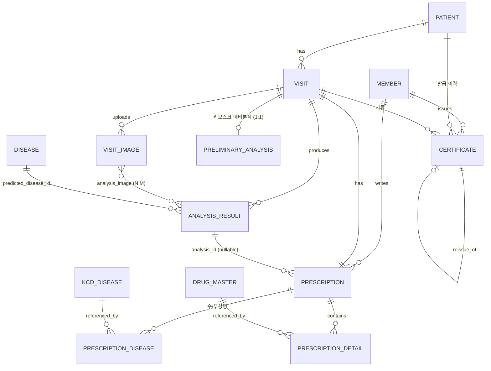

| 테이블 | 설명 |
| --- | --- |
| `member` | 회원 계정. login_id(unique), password(BCrypt), name, license_number, department, role |
| `patient` | 환자 마스터 |
| `visit` | 내원/접수, 8-state status, `reception_memo`, 키오스크 토큰 · 진료요약서 열람 토큰 |
| `visit_image` | 내원별 업로드 이미지 |
| `analysis_result` | AI 분석 결과(태스크, Top-K JSON, confidence · `confidence_level`, 히트맵 · 확대 히트맵, 모델 버전) |
| `analysis_image` | 분석↔이미지 N:M |
| `preliminary_analysis` | 대기실 키오스크 예비분석(내원 1:1, Top-K · 히트맵 · LLM 참고 소견) — 상태머신과 분리된 사이드 채널 |
| `certificate` | 제증명 발급대장(발급번호, 서류 종류 · 용도 · 제출처, 의사 스냅샷, `content_json`, AI 초안, ISSUED/VOID, 재발급 원본, 발급확인증 토큰) |
| `disease` | AI 클래스 마스터(피부 병변 8종 + 얼굴 6종) |
| `kcd_disease` | KCD 상병코드(약 5만 행) |
| `drug_master` | 약품/처방코드(약 50만 행) |
| `prescription` | 처방 헤더(작성자 `member_id` + `member_name` 스냅샷, `revisit_recommended_date`, `doctor_notes`, AI 코멘트) |
| `prescription_disease` | 처방-상병 매핑, `is_primary`로 주/부상병 구분 |
| `prescription_detail` | 처방 상세(약품·용법·기간·주의사항) |

**설계 포인트** — `analysis_result`(AI 예측)는 `prescription`(의료진 확정 처방)과 분리되어 있으며, `prescription.analysis_id`는 **nullable** 이라 AI 분석 결과 없이도 처방을 저장할 수 있다(임상 안전성). 주/부상병은 `prescription_disease`로 N:M 모델링되어 한 처방에 여러 상병을 붙일 수 있다. 증명서는 발급 시점의 문서를 통째로 보존해, 나중에 환자 정보가 바뀌어도 재발급하면 처음과 같은 문서가 나온다.

---

## 🧰 기술 스택

| 구분 | 기술 |
| --- | --- |
| **Frontend** | React 19.2, TypeScript 6, Vite 8, React Router 7, Tailwind CSS v4 |
| **Backend** | Java 21, Spring Boot 3.5.14, Spring Web, Spring Data JPA, **Spring Security**, **jjwt 0.12.6**, **Flyway**, Springdoc OpenAPI 2.8.8, AWS SDK v2 (S3), Anthropic Java SDK 3.2, Apache POI 5.2 (대용량 Excel SAX 스트리밍), Lombok |
| **AI Server** | FastAPI 0.115, PyTorch 2.13 (CPU), torchvision 0.28, timm 1.0.11, Pillow 13, NumPy |
| **AI Explainability** | GradCAM / LayerCAM (순수 PyTorch + Pillow 구현, cv2 불필요) · 확대 히트맵 · 확대 재판정 |
| **LLM** | Google Gemini API (`gemini-3.1-flash-lite`, 대체 `gemini-3.5-flash-lite`·`gemini-flash-lite-latest`) + 보조 Anthropic Claude API (`claude-haiku-5-5`) — 처방 코멘트·증명서 초안·키오스크 소견 |
| **Database** | MySQL 8.0 (utf8mb4_unicode_ci) |
| **Cloud (AWS)** | CloudFront · S3 · Route 53 · Certificate Manager · Application Load Balancer · EC2 Auto Scaling (t4g, Graviton) · ECR · Systems Manager Parameter Store · CloudWatch · IAM (GitHub OIDC) |
| **CI/CD · Dev** | GitHub Actions (CI · Deploy · Deploy Web · Deploy AI), Docker, Docker Compose, Caddy(한 서버 구성 HTTPS), Gradle, Playwright |
| **Peripheral** | print-agent (Python · python-escpos, 80mm 감열지), Telegram Bot API |

---

## 📂 폴더 구조

```text
2026-1-CECD1-5-Artifact-9/
├── backend/                         # Spring Boot REST API
│   ├── src/main/java/com/artifact/diagnosis/
│   │   ├── analysis/                # AI 분석 결과 · 히트맵 · 확대 히트맵
│   │   ├── certificate/             # 제증명 발급 · AI 초안 · 발급대장
│   │   ├── docshare/                # QR 공개 문서(발급확인증 · 진료요약서)
│   │   ├── kiosk/                   # 대기실 키오스크 · 예비분석
│   │   ├── print/                   # 감열지 출력 작업 큐
│   │   ├── notification/            # 텔레그램 접수 알림
│   │   ├── llm/ · gemini/ · claude/ # LlmGateway 대체 체인 + 공급자별 클라이언트
│   │   ├── common/                  # Security · JWT · CORS · AWS · 헬스체크 · 예외 처리
│   │   ├── disease/ · drug/         # AI 클래스 · KCD 상병코드 · 약품 마스터
│   │   ├── image/                   # ImageStorageService (Local/S3)
│   │   ├── member/ · patient/       # 회원/인증 · 환자
│   │   ├── prescription/            # 처방 + AI 처방 코멘트
│   │   └── visit/                   # 내원 · 상태머신 · VisitImage
│   ├── src/main/resources/
│   │   ├── db/migration/            # Flyway V1 ~ V13
│   │   └── data/                    # kcd_disease.xlsx, drug_master.xlsx
│   └── Dockerfile
├── frontend/                        # React 19 + Vite + Tailwind v4
│   └── src/
│       ├── api/                     # REST 클라이언트 (VITE_API_BASE_URL 로 API 출처 분리)
│       ├── auth/                    # 직책별 화면 권한
│       ├── components/              # 히트맵 · 사진 자르기 · 증명서 문서 · 검색 모달 …
│       ├── demo/                    # 로그인 없는 데모 — 탭 안의 가짜 백엔드
│       └── pages/                   # Login, Reception, Clinic, Lookup, Certificate,
│                                    # KioskWaiting, KioskAnalyze, WaitingBoard, Shared*
├── fastapi/                         # FastAPI AI inference server
│   ├── main.py                      # /predict-base64 · /health · /health/ready + GradCAM
│   ├── model.pth · models/facial.pth
│   ├── training/ · notebooks/       # 학습 스크립트 · Colab 노트북
│   └── tests/                       # 계약 테스트 · 평가 기준선(baselines)
├── print-agent/                     # 감열지 프린터 에이전트 (접수 데스크 맥)
├── deploy/aws/                      # AI 인스턴스 시작 스크립트 · IAM · 버킷 정책 견본
├── docker/                          # MySQL 초기화 · Caddy(한 서버 HTTPS)
├── docs/
│   ├── architecture/                # 아키텍처 · 시나리오 · 비용 그림(.png · .excalidraw) · 비용 비교 PDF
│   ├── images/readme/               # README 화면
│   └── aws-elb-asg-guide.md 외      # 배포 · CI/CD · 데모 · 운영 문서
├── .github/workflows/               # ci · deploy · deploy-web · deploy-ai
├── docker-compose.yml               # 로컬 / 한 서버 기본
├── docker-compose.prod.yml · docker-compose.https.yml · docker-compose.elb.yml
└── README.md
```

---

## ⚙️ 실행 방법

> 실제 포트는 로컬 환경에 따라 달라질 수 있다.

### 0) 설치 없이 둘러보기

[artifact-medical.site](https://artifact-medical.site) → 「로그인 없이 데모 체험하기」. 로컬에서도 프론트만 띄우면(`npm run dev`) 같은 데모를 백엔드 없이 쓸 수 있다.

### 1) Docker로 전체 4개 서비스 한 번에 실행 (권장)

```bash
cp .env.example .env   # JWT_SECRET · INTERNAL_API_SECRET 은 반드시 채운다
docker compose up --build
```

빌드 후 아래 순서로 자동 기동된다.

```
mysql (healthcheck 통과) → backend + fastapi → frontend(nginx)
```

#### 기동 확인 점검 순서

| 순서 | 확인 내용 | 명령어 / URL |
| --- | --- | --- |
| 1 | 4개 컨테이너 모두 `Up` 상태 | `docker compose ps` |
| 2 | MySQL healthcheck `(healthy)` 표시 | `docker compose ps mysql` |
| 3 | Backend 헬스체크 | `curl -s http://localhost:8080/api/health` → `{"status":"UP"}` |
| 4 | FastAPI 모델 로드 확인 | `curl -s http://localhost:8000/health/ready` → `{"status":"ready",...}` |
| 5 | nginx → backend 프록시 동작 | `curl -s http://localhost:3000/api/health` → `{"status":"UP"}` |
| 6 | 프론트엔드 SPA 로드 | 브라우저에서 `http://localhost:3000` 접속 → 로그인 화면 |
| 7 | SPA 라우팅 fallback | 브라우저에서 `http://localhost:3000/main` 직접 접속 → 빈 화면 아닌 정상 라우팅 |

> Backend 첫 기동 시 KCD / 약품 Excel 비동기 적재(`data-initializer` 스레드)가 수분 걸릴 수 있다.  
> 적재 완료 전에는 검색 결과가 비어 보인다.

#### 로그 확인 (서비스별)

```bash
docker compose logs -f frontend   # nginx 접근 로그
docker compose logs -f backend    # Spring Boot 로그
docker compose logs -f fastapi    # FastAPI 추론 로그
docker compose logs -f mysql      # MySQL 로그
```

#### 컨테이너 재빌드 (코드 변경 후)

```bash
docker compose up --build
```

### 2) 로컬 Frontend 단독 개발 (선택)

백엔드 3개 서비스는 Docker로 띄우고, 프론트만 Vite dev 서버로 실행하는 방식이다.

```bash
# 터미널 1: 백엔드 서비스 실행
docker compose up mysql fastapi backend

# 터미널 2: Vite dev 서버 (HMR 지원)
cd frontend
npm install
npm run dev
```

### 3) 운영 배포

| 구성 | 방법 |
| --- | --- |
| AWS 분리 배포 (화면 CloudFront · API ALB · AI 오토스케일링) | [`docs/aws-elb-asg-guide.md`](docs/aws-elb-asg-guide.md) — 콘솔에서 만드는 순서, 저장소 변수, 넘어가기 · 되돌리기 · 정리 |
| EC2 한 대 (Docker Compose + Caddy HTTPS) | [`docs/cicd-guide.md`](docs/cicd-guide.md) — self-hosted 러너 · `docker-compose.prod.yml` · `docker-compose.https.yml` |

### 기본 접속 주소

| 서비스 | Docker 전체 실행 | 로컬 개발 |
| --- | --- | --- |
| **Frontend** | `http://localhost:3000` | `http://localhost:5173` |
| Backend | `http://localhost:8080` | `http://localhost:8080` |
| FastAPI | `http://localhost:8000` | `http://localhost:8000` |
| Swagger | `http://localhost:8080/swagger-ui/index.html` | `http://localhost:8080/swagger-ui/index.html` |

### 계정 만들기

기본 계정은 저장소에 포함되어 있지 않다. 둘 중 하나로 만든다.

| 방법 | 절차 | 만들어지는 역할 |
| --- | --- | --- |
| 화면에서 회원가입 | `http://localhost:3000` → 회원가입 탭 | `DOCTOR` / `NURSE` / `STAFF` |
| 환경 변수로 자동 생성 | `.env`에 `ADMIN_LOGIN_ID`, `ADMIN_PASSWORD` 지정 후 재기동 | `ADMIN` |

> `ADMIN`은 회원가입으로 만들 수 없다. 가입 API가 인증 없이 열려 있어, 허용하면 누구나 관리자가 되기 때문이다.

### Docker Compose 서비스 구성

| 서비스 | 내용 |
| --- | --- |
| `mysql` | `mysql:8.0`, port `3306`, database `artifact_db`, healthcheck 적용 |
| `fastapi` | build `./fastapi`, port `8000`, `INTERNAL_API_SECRET` · `LOW_CONFIDENCE_THRESHOLD` · 히트맵 설정 주입 |
| `backend` | build `./backend`, port `8080`, `depends_on: mysql(healthy)`, FastAPI URL `http://fastapi:8000`, LLM 키 주입, 기동 시 Flyway 마이그레이션 |
| `frontend` | build `./frontend` (node:20 빌드 → nginx:alpine 서빙), port `3000:80`, `/api/` 요청을 `backend:8080`으로 프록시 |

---

## 🔐 환경 변수 (`.env` 예시)

> 저장소의 [`.env.example`](.env.example)을 복사해 쓴다 — `cp .env.example .env`. 운영(AWS 분리 배포) 값은 [`.env.production.example`](.env.production.example).

```env
# JWT — 필수. 비어 있으면 서버가 기동되지 않는다.  생성: openssl rand -base64 48
JWT_SECRET=
# 백엔드 ↔ AI 서버 공유 비밀 — 필수. 둘이 같아야 분석이 된다.  생성: openssl rand -base64 32
INTERNAL_API_SECRET=

# DB
DB_PASSWORD=rootpass

# 초기 관리자 계정 (선택). 비워두면 ADMIN 계정을 만들지 않는다.
ADMIN_LOGIN_ID=
ADMIN_PASSWORD=

# 이미지 저장소 (local: 디스크 / s3: AWS S3 — EC2 에서는 인스턴스 역할이면 키를 비운다)
IMAGE_STORAGE_TYPE=local
IMAGE_LOCAL_UPLOAD_DIR=/tmp/artifact-images
AWS_ACCESS_KEY=
AWS_SECRET_KEY=
AWS_REGION=ap-northeast-2

# LLM (처방 코멘트·증명서 초안·키오스크 소견)
GEMINI_API_KEY=
# 선택: Gemini 가 모두 실패할 때 대신 답할 Claude 키
ANTHROPIC_API_KEY=

# 법정 서식에 찍히는 병원 정보 (비우면 해당 칸이 빈 채로 출력)
HOSPITAL_NAME=아티팩트 피부과의원
HOSPITAL_ADDRESS=
HOSPITAL_PHONE=
HOSPITAL_REGISTRATION_NO=

# 텔레그램 접수 알림 (선택)
TELEGRAM_ENABLED=false
TELEGRAM_BOT_TOKEN=
TELEGRAM_CHAT_ID=
TELEGRAM_PUBLIC_BASE_URL=
```

- 로컬 개발에서는 `IMAGE_STORAGE_TYPE=local`로 설정하면 **실제 AWS 없이** 이미지 업로드/분석 흐름을 검증할 수 있다.
- 화면과 API를 다른 출처에 두는 배포(CloudFront + ALB)에서는 백엔드 `CORS_ALLOWED_ORIGINS` · `PRINT_KIOSK_ALLOWED_BASE_URLS` 에 화면 주소를 넣고, 화면은 빌드할 때 `VITE_API_BASE_URL=https://api.<도메인>` 을 준다.
- LLM 키(`GEMINI_API_KEY`, `ANTHROPIC_API_KEY`)가 하나도 없으면 코멘트 API는 *"AI API 키가 설정되지 않았습니다."* 를 반환한다(앱은 정상 동작). 둘 중 하나만 있어도 그 공급자로 동작한다.
- `ANTHROPIC_API_KEY` 를 넣으면 식별정보를 지운 프롬프트(상병·접수 메모·처방 정보)가 Anthropic(미국)에도 전송된다. 운영에 켜기 전에 개인정보 처리방침·국외 이전 고지를 함께 고친다.
- **`JWT_SECRET` · `INTERNAL_API_SECRET` 은 환경마다 다른 값을 쓴다.** 이 키를 아는 사람은 로그인 없이 임의의 사용자·권한으로 토큰을 위조하거나 AI 서버를 직접 부를 수 있으므로, 저장소·이슈·메신저에 값을 남기지 않는다(AWS 에서는 Parameter Store SecureString 에 둔다).

---

## 🌐 API 요약

> 전체 스펙은 Swagger UI(`/swagger-ui/index.html`)에서 확인한다. 아래 🔓 표시(인증 · 헬스체크 · 키오스크 토큰 · 공개 문서 토큰)를 제외한 모든 API는 **JWT 인증 필수**이고, 직책 권한을 따른다.

| Domain | Method | Endpoint | Description |
| --- | --- | --- | --- |
| **Auth** 🔓 | POST | `/api/v1/auth/signup` · `/api/v1/auth/login` | 회원가입 · 로그인 → JWT 발급 |
| Health 🔓 | GET | `/api/health` | 로드 밸런서 상태 검사 → `{"status":"UP"}` |
| Patient | POST · GET | `/api/v1/patients` · `/api/v1/patients/{id}` · `/api/v1/patients/search` | 환자 등록 · 조회 · 통합 검색 |
| Visit | POST · GET | `/api/v1/visits` · `/api/v1/visits/{id}` | 접수 생성(`RECEIVED`) · 목록 · 단건 |
| Visit | PATCH | `/api/v1/visits/{id}/start` · `/diagnose` · `/complete` | 진료 시작 · 진단 확정 · 진료 완료 |
| Visit | DELETE | `/api/v1/visits/{id}` | 접수취소 (처방 전까지) |
| Visit | POST | `/api/v1/visits/{id}/kiosk-token` | 키오스크 QR 토큰 발급 |
| Image | POST · GET | `/api/v1/visits/{visitId}/images` · `/images/{imageId}/content` | 이미지 업로드 · 목록 · 바이트 |
| **Analysis** | POST · GET | `/api/v1/visits/{visitId}/analysis` | AI 분석 요청(`→ ANALYZING → ANALYZED`) · 최근 결과(Top-5) |
| Analysis | GET | `/api/v1/visits/{visitId}/analysis/heatmap` · `/heatmap/crops/{rank}` | GradCAM 히트맵 · 확대 히트맵 |
| Preliminary | GET | `/api/v1/visits/{visitId}/preliminary` (+ `/heatmap`, `/heatmap/crops/{rank}`) | 진료실에서 보는 키오스크 예비분석 |
| **Kiosk** 🔓 | GET | `/api/kiosk/pending` · `/api/kiosk/session/{token}` | 대기 접수 · 토큰 세션(본인 확인) |
| Kiosk 🔓 | POST | `/api/kiosk/session/{token}/analyze` · `/comment` | 예비분석 · 참고 소견 |
| Master | GET | `/api/v1/kcd-diseases?query&page&size` · `/api/v1/drugs?query&page&size` | KCD 상병코드 · 약품/처방코드 검색 |
| **Prescription** | POST · GET | `/api/v1/visits/{visitId}/prescription` | 처방 저장(`→ PRESCRIBED`) · 조회 |
| Prescription | POST | `/api/v1/visits/{visitId}/prescription/comment` | AI 처방 코멘트 |
| Prescription | GET | `/api/v1/prescriptions/doctor-patients?doctorId&from&to` | 의사별 환자 처방 이력 (기간) |
| **Certificate** | POST | `/api/v1/visits/{visitId}/certificates/draft` · `/api/v1/visits/{visitId}/certificates` | 서류 AI 초안 · 발급 |
| Certificate | GET · POST | `/api/v1/certificates` · `/{id}` · `/{id}/reissue` · `/{id}/void` | 발급대장 · 재발급 · 무효 |
| Document 🔓 | GET · POST | `/api/public/documents/certificate/{token}` (+ `/verify`) · `/visit-summary/{token}` | QR 문서 열람 (증명서는 생년월일 확인) |
| Print | POST | `/api/v1/visits/{visitId}/print/ticket` · `/print/visit-summary` · `/api/v1/certificates/{id}/print/slip` | 접수증 · 진료요약서 · 발급확인증 출력 |
| Print | GET · POST | `/api/v1/print/jobs/next` · `/{jobId}/result` · `/status` | print-agent 출력 작업 큐 |

---

## 🤖 AI 모델 설명

| 항목 | 내용 |
| --- | --- |
| **모델** | EfficientNet-B0 (timm) × 2 — `skin_lesion`(기본) · `facial` |
| **목적** | 점·피부 병변 8종 분류 / 얼굴 피부질환 6종 분류 |
| **입력 전처리** | Resize 224×224(피부 병변) · 384×384(얼굴), Normalize (ImageNet mean/std) |
| **출력** | Top-1 / Top-5 질환 + confidence, **GradCAM 오버레이 (원본 해상도 보존)** + 확대 히트맵(최대 3장) |
| **확신도 경고** | `top1_confidence < LOW_CONFIDENCE_THRESHOLD`이면 `confidence_level="low"` — 결과는 그대로 내보내고 화면에 경고만 붙인다 |
| **확대 재판정** | 피부 병변에서 원본 신뢰도가 경고선 미만이면 확대 영역들의 판정을 섞어 다시 판정한다(얼굴은 사용하지 않음 — 실사진에서 정답률이 떨어졌다) |
| **GradCAM 구현** | 순수 PyTorch + Pillow, cv2/grad-cam 라이브러리 불필요 — LayerCAM 을 `blocks.4`(14×14)·`blocks.2`(28×28) 두 레이어에 걸어 산술평균으로 융합. `conv_head`(7×7) 는 쓰지 않는다 — 그 위치의 CAM 은 클래스를 구분하지 못한다(근거는 `fastapi/main.py` 의 `_select_cam_layers` 독스트링) |
| **모델 파일** | `fastapi/model.pth` · `fastapi/models/facial.pth` (`MODEL_PATH_<TASK>` 로 바꿀 수 있다) |
| **학습** | `fastapi/notebooks/` · `fastapi/training/` · `docs/ai-colab-workflow.md` |

### 성능 (홀드아웃)

| 모델 | 지표 | 값 |
| --- | --- | ---: |
| 피부 병변 (8종) | Top-1 · Top-3 · Top-5 정확도 | 83.9% · **98.5%** · 99.6% |
| 피부 병변 (8종) | 위험군(악성 · 전암) Top-3 | 98.7% (755장 중 745장) |
| 피부 병변 (8종) | 흑색종 재현율 | 89.3% — 결과를 막지 않고 경고로 알린다 |
| 얼굴 (6종) | 정확도 (정면 · 측면) | 92.3% (84.7% · 100%) |

> 피부 병변: 고정 홀드아웃 2,857장(환자 단위 분할), 2026-10-22 측정. 얼굴: 홀드아웃 1,200장, 384 입력(`fastapi/tests/baselines/`).

### 지원 질환 클래스

**피부 병변 (`skin_lesion`, 8종)**

| 코드 | 한글명 | 영문 |
| --- | --- | --- |
| `akiec` | 광선각화증 / 상피내암 | Actinic keratoses / intraepithelial carcinoma |
| `bcc` | 기저세포암 | Basal cell carcinoma |
| `bkl` | 양성 각화증성 병변 | Benign keratosis-like lesions |
| `df` | 피부섬유종 | Dermatofibroma |
| `mel` | 악성 흑색종 | Melanoma |
| `nv` | 멜라닌세포모반 | Melanocytic nevi |
| `vasc` | 혈관성 병변 | Vascular lesions |
| `inflammatory` | 염증성 피부질환 | Inflammatory skin condition |

**얼굴 피부 (`facial`, 6종)**

| 코드 | 한글명 | 영문 |
| --- | --- | --- |
| `acne` | 여드름 | Acne |
| `atopic` | 아토피피부염 | Atopic dermatitis |
| `normal` | 정상 피부 | Normal skin |
| `psoriasis` | 건선 | Psoriasis |
| `rosacea` | 주사(장미증) | Rosacea |
| `seb_derm` | 지루피부염 | Seborrheic dermatitis |

### FastAPI 엔드포인트

| Method | Endpoint | 설명 |
| --- | --- | --- |
| GET | `/health` | 헬스 체크 (device, LOW_CONFIDENCE_THRESHOLD, model_version, classes, CAM 레이어 노출) |
| GET | `/health/ready` | 모든 태스크 모델이 로드됐을 때만 200 — 로드 밸런서 상태 검사용 |
| POST | `/predict` | 이미지 파일 기반 추론 (Swagger / curl) — 공유 비밀 헤더 필요 |
| POST | `/predict-base64` | base64 이미지 기반 추론 (백엔드 연동용, `task` 로 모델 선택) — 공유 비밀 헤더 필요 |

> **주의**: 본 시스템은 의료진의 의사결정을 보조하는 prototype이며, 실제 의료 진단을 대체하지 않는다.

---

## 💬 AI 처방 코멘트 — 작동 방식

1. 백엔드 `AiCommentService.generateComment()` 가 호출된다.
2. DB `drug_master`에서 *"연고", "크림"* 을 포함하는 약품 최대 10개를 후보 풀로 추출한다.
3. 다음 형태의 한국어 프롬프트를 만든다. 접수 메모는 식별정보를 지운 뒤에만 들어간다.
   - 주상병 / 부상병 / 접수 메모
   - 후보 약품(약품명+코드 페어 목록)
   - 출력 규칙: **정확히 2줄**, 1줄 처방 방향(약품명+코드 포함), 2줄 환자 주의사항
4. `LlmGateway` 가 공급자를 차례로 시도해 처음 성공한 답을 쓴다.
   - `GEMINI_MODEL`(기본 `gemini-3.1-flash-lite`) → `GEMINI_FALLBACK_MODELS`(기본 `gemini-3.5-flash-lite,gemini-flash-lite-latest`) → Claude(`ANTHROPIC_API_KEY` 가 있을 때만)
   - 503·429·5xx·타임아웃을 낸 공급자는 60초 동안 건너뛴다. 키·모델명 오류는 10분. 예산이 모자라 짧게 끊은 타임아웃은 공급자 탓이 아니므로 쉬게 하지 않는다.
   - 요청 하나가 체인 전체에 쓰는 시간은 30초를 넘지 않는다(키오스크는 20초). 앞단 nginx · ALB 가 60초에 끊기 때문이다.
   - Claude 키가 있으면 Gemini 모델들에게 줄 시간에서 12초를 Claude 몫으로 남긴다. Gemini 가 응답 없이 시간을 끌어도 Claude 는 한 번 시도된다.
   - 길이 제한으로 잘린 답, 증명서 초안에서 JSON 형식이 아닌 답은 성공으로 치지 않고 다음 공급자로 넘어간다.
5. 응답을 두 줄(`line1`, `line2`)과 실제로 답한 모델명(`model`)으로 프론트에 전달한다. 전부 실패하면 `available=false` 와 안내 문구를 주고, 화면은 그 문구를 코멘트 칸에 넣지 않는다.

---

## 🛠️ 트러블슈팅

| 증상 | 점검 사항 |
| --- | --- |
| 401 / 403 응답 | JWT 만료 또는 헤더 누락 — 다시 로그인해 토큰 재발급. 직책 권한 밖의 화면 · API 도 403 이다 |
| 모든 AI 분석이 401 / 실패 | 백엔드와 FastAPI 의 `INTERNAL_API_SECRET` 이 다르다(AWS 에서는 Parameter Store 값과 백엔드 `.env`) |
| 화면은 뜨는데 로그인하면 "서버에 연결할 수 없습니다" | API 주소(`VITE_API_BASE_URL`) 또는 백엔드 `CORS_ALLOWED_ORIGINS` 에 화면 주소가 없다 — 개발자 도구 네트워크 탭에서 요청 주소 확인 |
| MySQL 기동 실패 | 포트 `3306` 충돌 여부 확인 |
| 코드 변경이 반영되지 않음 | `docker compose up --build` 로 컨테이너 재빌드 |
| FastAPI 시작 실패 / `/health/ready` 503 | `fastapi/model.pth` · `fastapi/models/facial.pth` 누락 여부 확인 — 응답의 `missing` 에 빠진 태스크가 나온다 |
| 분석 화면(태블릿·진료실)에 "사진을 읽을 수 없습니다. JPEG/PNG 사진으로 다시 촬영해 주세요." (400) | AI 서버가 올린 파일을 사진으로 열지 못했다 — 이미지가 아닌 파일, HEIC(FastAPI 에 HEIF 플러그인이 없다), 손상되거나 잘린 파일, 0바이트, 2억 화소를 넘는 사진. 정확한 사유는 백엔드 로그의 `FastAPI 가 사진을 열지 못함` WARN 줄에 FastAPI 본문(`detail.message`)으로 남는다. 같은 사유가 되풀이되면 촬영 기기 설정(예: 아이폰 카메라 "높은 호환성")이나 화면 쪽을 고친다. 같은 400 이라도 깨진 base64·모르는 태스크 이름은 사진이 아니라 백엔드 요청 문제라 500 으로 남는다(`FastApiErrors` 주석) |
| 검색 결과가 비어 있음 | 백엔드 첫 기동의 비동기 적재(`data-initializer` 스레드) 완료 여부, `resources/data/*.xlsx` 존재 여부 확인 |
| S3 관련 오류 | 환경변수 미설정 시 `IMAGE_STORAGE_TYPE=local` 권장 |
| GradCAM 히트맵이 보이지 않음 | FastAPI 로그에서 `[GradCAM] CAM 계산 실패` 또는 `[GradCAM] 히트맵 렌더링 실패` 라인 확인 — 분석 결과 자체는 정상 동작 |
| 히트맵이 넓게 퍼져 흐릿함 | 오염이 아니라 정직한 표시다 — 모델이 한 곳을 근거로 삼지 못하면 연한 큰 얼룩으로 보인다. 응답의 `heatmap_quality.focus_area`(격자 CAM 이 0.5 이상인 칸의 비율 — 흐림을 거친 화면의 맵과는 조금 다르다)·`peak_ratio`(상위 10% 가 담은 CAM 에너지)가 그 상태를 서술하지만, **이 값으로 좋다/나쁘다를 판정하지는 말 것** — 실측에서 품질과 상관이 없었다(`fastapi/main.py` 의 `_cam_quality` 독스트링). 색의 진하기는 `HEATMAP_ALPHA_MIN`(기본 0.25)·`HEATMAP_ALPHA_MAX`(기본 0.60), 흐림은 `HEATMAP_SMOOTH`(기본 0.03)로 조절한다 — 셋 다 색만 바꾼다. `HEATMAP_CROPS`(기본 3, 0~3)는 화면에 보여 줄 확대 히트맵 수만 바꾼다 — 확대 재판정은 이 값과 상관없이 최대 3곳으로 한다. 넷 다 `docker-compose.yml` 이 `.env` 에서 넘긴다. 현재 값과 CAM 레이어는 `/health` 가 돌려준다 |
| AI 코멘트가 "키가 설정되지 않았습니다." | `GEMINI_API_KEY`(또는 `ANTHROPIC_API_KEY`) 환경변수 설정 후 재기동 |
| AI 코멘트가 "일시적으로 혼잡합니다" | 모든 공급자가 실패했고, 그중 적어도 하나가 일시 장애(503·429·5xx·타임아웃)였다는 뜻이다. 나머지는 키·모델명 오류일 수 있으므로 백엔드 로그의 `LLM [...] 모든 공급자 실패:` 줄에서 공급자별 결과(AUTH·MODEL_NOT_FOUND·BILLING 등)를 확인한다. 설정 문제는 ERROR 로그로 따로 남는다. Claude 키가 없으면 Google 쪽 장애가 길어질 때 대신 답할 곳이 없다 — `ANTHROPIC_API_KEY` 설정을 검토 |
| 잘못된 상태 전이 (`409 IllegalState`) | Visit 상태머신 위반 — 화면을 새로고침해 최신 상태 확인 |
| "확신 낮음" 경고가 너무 자주/드물게 뜸 | `LOW_CONFIDENCE_THRESHOLD` 조정 (올리면 경고가 잦아진다). 근거 수치는 `fastapi/tests/README.md` |
| AWS 배포에서 막힘 (DNS · 인증서 · CORS · 대상 그룹 unhealthy) | [`docs/aws-elb-asg-guide.md`](docs/aws-elb-asg-guide.md) 13절 "자주 막히는 곳" |

---

## 🚀 향후 개선 계획

> **예정 기능**이며, 위 "핵심 기능"의 구현 항목과 구분된다.

- **백엔드 · DB 다중화** — 백엔드 오토스케일링 + RDS Multi-AZ + S3 사진 저장 ([시나리오 B](docs/architecture/05-scenario-b-scale-out.png))
- **AI 분석 비동기화** — SQS 큐 + 큐 길이로 늘어나는 일꾼, 행사처럼 요청이 몰릴 때 타임아웃 없이 처리 ([시나리오 C](docs/architecture/06-scenario-c-queue.png))
- **보안 강화** — 프라이빗 서브넷 · NAT · WAF · Session Manager ([시나리오 D](docs/architecture/07-scenario-d-security.png))
- AI 모델 **성능 모니터링 대시보드**, 실사진 기반 재학습(Active Learning) 루프, 얼굴 모델의 촬영 조건 강건성 개선
- 처방 다중 약품 입력 UX 정교화 (드래그 정렬, 템플릿 자동 채움)
- LLM 코멘트의 **임상 안전 가드레일** 강화 (약품 풀 동적 매핑, 알레르기/상호작용 점검)
- 실제 **EMR 연동 가능성** 검토 (비트컴퓨터 산학 연계)

---

## 🏷️ 릴리즈

| 버전 | 날짜 | 내용 |
| --- | --- | --- |
| **v2.0.0** | 2026-11-24 | 얼굴 피부 모델 · 대기실 키오스크 예비분석 · 증명서 실제 발급 · 감열지 출력 · 대기 현황판 · 데모 체험 · LLM 대체 체인 · AWS 분리 배포(CloudFront · ALB · Auto Scaling) |
| v1.0.0 | 2026-06-03 | 1학기 최종 — 피부 병변 AI 분석 + GradCAM, 접수 · 진료 · 처방 · 조회, Gemini 처방 코멘트 |
| v0.1.1 | 2026-05-30 | README 정비 |
| v0.1.0 | 2026-05-29 | 첫 공개 버전 |

---

## 🌿 팀 협업 / 브랜치 전략

| 브랜치 | 용도 |
| --- | --- |
| `main` | 발표/배포 가능한 안정 버전 — 머지되면 GitHub Actions 가 배포한다 |
| `dev` | 통합 개발 브랜치 |
| `[name]/[feature]`, `feature/*`, `fix/*`, `docs/*` | 개인/기능 브랜치 |

- 모든 변경은 **PR 기반 병합**을 원칙으로 하고, CI 가 통과해야 머지한다.
- 릴리즈는 SemVer 태그로 남긴다 — 예: `v2.0.0`.

---

## 📄 참고 사항

- 본 프로젝트는 **동국대학교 종합설계(캡스톤디자인)** 과정에서 EMR 솔루션 전문 기업 **비트컴퓨터(Bitcomputer)** 와의 산학 협력으로 진행되었다.
- 사용된 KCD 상병코드 및 약품/처방코드 마스터 데이터는 학습/연구 목적의 데모용이며, 라이선스 및 사용 범위는 원 데이터 제공처의 정책을 따른다.
- HAM10000 등 공개 데이터셋은 각 데이터셋의 라이선스 및 DUA(Data Use Agreement)를 준수한다.
- Gemini API 사용 시 Google Cloud / Generative Language API의 요금 및 정책을 준수한다.
