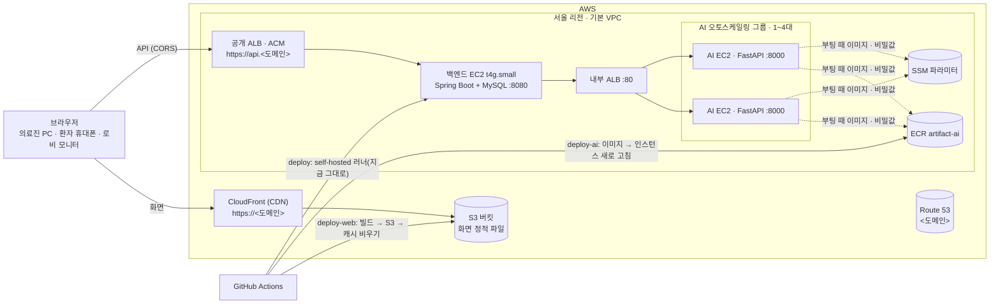

# AWS 실습 — 화면(S3 · CloudFront) · ALB · AI 오토스케일링으로 나누기

> 지금까지는 EC2 한 대(`t4g.small`)에 화면·백엔드·AI·DB·HTTPS(Caddy)를 전부 올렸다. 이 문서는 그것을
> **화면은 S3 + CloudFront, API 는 ALB 뒤 백엔드 EC2, AI 는 내부 ALB 뒤 오토스케일링 그룹**으로 나누는 실습 절차다.
> 도메인은 Route 53 에서 사고, **화면부터 옮긴다**(그동안 API 는 지금 서버). 그다음 AWS 백엔드를 만들고 마지막에 API 주소만
> 바꿔 넘어간다. 콘솔에서 사람이 눌러야 하는 것을 순서대로 적었다.
>
> 관련 파일: `.github/workflows/deploy-web.yml`(화면 → S3 · CloudFront), `.github/workflows/deploy-ai.yml`(AI → ECR · 인스턴스 새로 고침),
> `.github/workflows/deploy.yml`(백엔드 EC2, `DEPLOY_TARGET`), `docker-compose.elb.yml`, `frontend/src/api/base.ts`(`VITE_API_BASE_URL`),
> `deploy/aws/ai-user-data.sh`, `deploy/aws/iam/*.json`(IAM·버킷 정책 견본)
>
> **AWS 리소스는 전부 콘솔에서 직접 만든다.** 손으로 익히는 실습이라 CloudFormation·Terraform 같은 코드로 만들지 않는다.
> 저장소에 있는 것은 배포 워크플로(GitHub Actions)와 IAM·버킷 정책 견본(JSON)뿐이고, 버킷·배포·로드 밸런서·오토스케일링 그룹은
> 사람이 누른다. 각 절 끝의 **확인**은 콘솔이 대신 만들어 준 것을 직접 열어 보는 순서다.

---

## 0. 한눈에 보기

### 왜 화면을 따로 빼나

화면(React)은 빌드하면 **정적 파일**(html·js·css·이미지)뿐이다. 서버에서 실행할 코드가 없으니 EC2 에 둘 이유가 없다.

- S3 에 올리고 CloudFront(CDN)가 내보내면 서버 관리가 없고, 가까운 지점에서 캐시로 빨리 나간다
- 백엔드·AI 를 배포하거나 늘리고 줄여도 화면은 영향이 없다(반대도 마찬가지)
- 비용이 거의 0 이다(CloudFront 는 월 1TB·1천만 요청까지 상시 무료)
- 대신 화면과 API 의 주소가 달라져 CORS 설정이 필요하다 — 코드는 이미 준비돼 있다(`VITE_API_BASE_URL`, 백엔드 CORS)

Vercel 도 같은 일을 하지만, 학교 조직 저장소에 Vercel 앱을 설치하려면 조직 관리자 승인이 필요하다. S3 + CloudFront 는
이미 쓰는 GitHub Actions 로 배포하므로 조직 설정이 필요 없고, AWS 실습 범위에도 들어간다(Vercel 은 부록 A).

### 그림 · 비용 비교 문서

그림은 `docs/architecture/` 에 있다(PNG, 원본 `.excalidraw` 는 [excalidraw.com](https://excalidraw.com) 에서 열어 고칠 수 있다).
구성별 비용 · 장단점을 묶은 문서는 `docs/architecture/artifact-architecture-cost.pdf`(A4 가로 20쪽).

| 그림 | 내용 |
|---|---|
| [01 지금 구조](architecture/01-asis-single-ec2.png) | EC2 한 대에 화면 · API · AI · DB · Caddy 전부 (월 약 $22) |
| [02 바꿀 구조 — 요청 흐름](architecture/02-tobe-request-flow.png) | Route 53 · CloudFront · S3 · ALB 2 · 백엔드 · AI 오토스케일링, VPC · 보안 그룹 사슬 (월 약 $109) |
| [03 바꿀 구조 — 배포 흐름](architecture/03-tobe-deploy-flow.png) | GitHub Actions 세 갈래 · OIDC · S3/CloudFront · ECR/인스턴스 새로 고침 · self-hosted 러너 |
| [04 시나리오 A](architecture/04-scenario-a-cost.png) | 실습이 끝나면: 화면만 CloudFront, 나머지는 서버 한 대 (월 약 $22) |
| [05 시나리오 B](architecture/05-scenario-b-scale-out.png) | 백엔드도 여러 대: RDS Multi-AZ · S3 사진 · 백엔드 오토스케일링 (월 약 $172) |
| [06 시나리오 C](architecture/06-scenario-c-queue.png) | AI 분석이 몰릴 때: SQS 큐 + 큐 길이로 늘어나는 일꾼 (월 약 $70~90) |
| [07 시나리오 D](architecture/07-scenario-d-security.png) | 보안 강화: 프라이빗 서브넷 · NAT · WAF · Session Manager (월 약 $163) |
| [08 비용 비교](architecture/08-cost-comparison.png) | 구성별 한 달 요금을 항목별로 쌓은 막대 + 장단점 |

### 구성 (끝난 모습)



| 무엇 | 어디서 | 배포 (main 에 머지하면 저절로) |
|---|---|---|
| 화면(React) | S3 + CloudFront, `https://<도메인>` | `deploy-web.yml` — `frontend/` 가 바뀐 커밋만 |
| 백엔드 + MySQL | 지금 쓰는 EC2(그대로 백엔드 서버가 된다 — DB 볼륨 유지), `https://api.<도메인>` | `deploy.yml` (self-hosted 러너) |
| AI(FastAPI) | 오토스케일링 그룹의 EC2 들 | `deploy-ai.yml` — `fastapi/` 가 바뀐 커밋만 |
| 도메인 · DNS | Route 53 | — |

배포는 전부 GitHub Actions 다. AWS 키를 저장하지 않고 OIDC 로 역할을 빌린다(3 단계).

### 순서

| 단계 | 하는 일 | 화면 | API |
|---|---|---|---|
| 0 | 이 문서의 코드가 main 에 머지됐는지 | duckdns | 지금 서버 |
| **1** | **도메인 — Route 53 호스팅 영역 · 네임서버 연결** (다른 곳에서 샀으면 1-A) — 몇 분~몇 시간 걸려 가장 먼저 | 〃 | 〃 |
| 2 | 화면 인프라: S3 버킷 · CloudFront 배포(인증서·도메인 연결은 마법사가 함께) | 〃 | 〃 |
| **3** | **GitHub → AWS 배포 권한(OIDC) · 화면 첫 배포 · 지금 서버에 새 화면 주소 허용** | **`<도메인>`** (+ duckdns 도 그대로) | 지금 서버 |
| 4 | 보안 그룹 4개 | 〃 | 〃 |
| 5 | AI 인스턴스 역할 · SSM 파라미터 | 〃 | 〃 |
| 6 | ECR · 첫 AI 이미지 | 〃 | 〃 |
| 7 | 내부 ALB · AI 오토스케일링 그룹 | 〃 | 〃 |
| 8 | 공개 ALB · 인증서(서울) · `api.<도메인>` | 〃 | 〃 |
| **9** | **백엔드 `DEPLOY_TARGET=elb` → 화면을 새 API 주소로 다시 배포** | `<도메인>` 만 | **ALB** |
| 10~12 | 오토스케일링 실습 · 되돌리기 · 정리 | | |

3 단계까지만 해도 화면은 S3 + CloudFront 와 새 도메인으로 돈다. 4~8 단계는 지금 사이트를 그대로 둔 채 만들고, 9 단계에서 넘어간다.

### 단계별로 익히는 것

| 단계 | AWS 개념 |
|---|---|
| 1 | Route 53 도메인 등록 · 호스팅 영역(NS·SOA 레코드가 저절로 생기는 이유) |
| 2 | S3 퍼블릭 액세스 차단 · CloudFront 오리진·OAC·캐시 정책 · 인증서 리전 규칙(CloudFront 는 us-east-1) · 별칭(Alias) 레코드 |
| 3 | IAM OIDC 공급자 · 신뢰 정책(누가 역할을 빌리나)과 권한 정책(무엇을 하나)의 차이 · 캐시 무효화 |
| 4 | 보안 그룹 체이닝(소스 = IP 가 아니라 보안 그룹) |
| 5 | 인스턴스 프로파일(EC2 가 키 없이 역할을 쓰는 방법) · Parameter Store SecureString |
| 6 | ECR 리포지토리 · 수명 주기 정책 |
| 7 | 대상 그룹·상태 검사 · 내부 ALB · 시작 템플릿·사용자 데이터·IMDSv2 · 오토스케일링 그룹·대상 추적 · 인스턴스 새로 고침 |
| 8 | 공개 ALB 리스너(HTTPS·리디렉션) · 인증서 DNS 검증 |
| 9~12 | 짧은 중단으로 넘어가기 · 되돌리기 · 요금이 멈추는 정리 순서 |

### 비용 (서울 리전 온디맨드, 730시간 기준 대략)

단가는 AWS 공개 요금 데이터(서울, 2026-11-23 조회)다. 세금 · 데이터 전송 · 크레딧은 뺐다.

| 항목 | 단가 | 월 | 비고 |
|---|---|---:|---|
| 도메인 | — | 연 $27 | 이 프로젝트는 `artifact-medical.site` 를 Vercel 에서 샀다(갱신가). Route 53 에서 산다면 `.com` 연 $15 안팎. **AWS 크레딧은 도메인 등록·이전 요금에 쓸 수 없다**(크레딧 약관) |
| Route 53 호스팅 영역 | $0.50/영역 | $0.50 | |
| S3 + CloudFront | — | ≈ $0 | 종량제의 CloudFront 상시 무료 한도(월 1TB·1천만 요청), S3 는 몇 MB |
| EC2 `t4g.small` × 3 (백엔드 1 + AI 2) | $0.0208/h | $45.5 | AI 가 4대로 늘면 늘어난 시간만큼 대당 시간 약 $0.028 더 |
| ALB × 2 (공개 + 내부) | $0.0225/h + LCU | $37.9 | 끌 수 없다 — 안 쓰면 지운다 |
| 공인 IPv4 × 5 | $0.005/h | $18.3 | 공개 ALB 2 + EC2 3. 내부 ALB 는 공인 IP 가 없다 |
| EBS 62 GB · ECR | $0.0912/GB-월 · $0.10/GB-월 | $6.4 | |
| CloudWatch 경보 | — | $0.2 | 대상 추적 정책이 만드는 경보 2개 |
| **합계** | | **약 $109/월 (하루 약 $3.6)** | 지금 한 서버 구성은 약 $22/월. 화면(1~3 단계)만 하면 약 $0.5/월 + 도메인 |

- 4~9 단계의 AWS 백엔드는 **기간을 정해 두고, 끝나면 12 단계로 지운다.** 크레딧 잔액·예산 알림은 `docs/booth-operation-guide.md` 1-1.
- vCPU 한도: AI 가 최대 4대면 백엔드 포함 10 vCPU 가 필요하다. EC2 → 한도(Limits)에서 "Running On-Demand Standard instances" 가
  10 이상인지 본다(`docs/booth-operation-guide.md` 1-2).

### 이 문서에서 쓰는 이름

`<도메인>` 은 화면 주소로 쓸 도메인이다. 이 프로젝트는 **`artifact-medical.site`**(Vercel 에서 등록) — API 는 `api.artifact-medical.site`.

| 이름 | 무엇 |
|---|---|
| `artifact-web-<고유문자>` | 화면 S3 버킷(이름은 전 세계에서 하나뿐이어야 한다) |
| `artifact-github-deploy` | GitHub Actions 가 빌려 쓰는 IAM 역할 |
| `artifact-ai` | ECR 저장소 |
| `artifact-ai-tg` / `artifact-ai-alb` | AI 대상 그룹 / 내부 ALB |
| `artifact-ai-lt` / `artifact-ai-asg` | AI 시작 템플릿 / 오토스케일링 그룹 |
| `artifact-backend-tg` / `artifact-api-alb` | 백엔드 대상 그룹 / 공개 ALB |

---

## 시작 전에

- 이 문서와 `.github/workflows/deploy-web.yml` 이 **main 에 머지돼 있어야 한다.** GitHub 은 기본 브랜치(main)에 있는 워크플로만
  수동 실행(Run workflow)을 보여 준다.
- 저장소 변수를 만들려면 저장소 **admin** 권한이 필요하다(Settings 탭이 안 보이면 권한이 있는 팀원에게 부탁한다).

---

## 1. 도메인 — Route 53 에서 사거나, 다른 곳에서 산 도메인을 Route 53 으로

등록에 몇 분에서 몇 시간(TLD 에 따라 더) 걸리므로 가장 먼저 한다. 기다리는 동안 2 단계의 S3 버킷까지는 만들 수 있다.

### 1-A. 다른 곳(Vercel 등)에서 이미 샀다면 — 네임서버만 Route 53 으로 (이 프로젝트: `artifact-medical.site`)

등록 기관(registrar)은 그대로 두고 **레코드를 관리하는 곳(네임서버)만 Route 53 으로 넘긴다.** 이 문서의 별칭 레코드 ·
인증서 자동 발급이 Route 53 기준이고, Vercel DNS 에 저절로 생기는 CAA 레코드(`letsencrypt.org` · `sectigo.com` · `pki.goog` 만 허용)가
그대로면 **AWS 인증서(ACM) 발급이 막히기** 때문이다.

1. Route 53 → **호스팅 영역** → **호스팅 영역 생성** → 도메인 이름 `artifact-medical.site`, 유형 **퍼블릭 호스팅 영역** → 생성(월 $0.50)
2. 만든 영역의 **NS 레코드 값 4개**를 복사한다(`ns-….awsdns-….com` · `.net` · `.org` · `.co.uk`, 끝의 점은 빼고)
3. Vercel → **Domains** → `artifact-medical.site` → **Nameservers** → **Edit** → `ns1/ns2.vercel-dns.com` 을 지우고 2번의 4개를 넣는다 → Save
4. 확인: `dig +short NS artifact-medical.site`(Windows 는 `nslookup -type=NS artifact-medical.site`)가 `awsdns` 를 보이면 끝.
   보통 수십 분, 길면 몇 시간. 그 뒤로 Vercel 의 DNS Records 화면은 쓰이지 않는다 — 레코드는 전부 Route 53 에서 고친다
5. Vercel 화면에서 함께 볼 것: **DNSSEC 은 켜지 않는다**(켠 채로 네임서버를 바꾸면 조회가 깨진다) ·
   **Manage WHOIS Privacy** 가 켜져 있는지(주소 · 전화가 공개 WHOIS 에 나가지 않게) · 자동 갱신은 실습 기간에 맞춰

네임서버가 Route 53 으로 바뀐 것을 확인한 뒤 2 단계로 간다(인증서 검증 레코드가 Route 53 에 생기므로, 그 전에는 인증서가 "검증 대기"에 머문다).

### 1-B. Route 53 에서 새로 산다면

1. AWS 콘솔 → **Route 53** → 왼쪽 **도메인 → 등록된 도메인** → **도메인 등록**
2. 원하는 이름을 검색 → 가격 확인 → **선택** → **결제 진행**
   - `.com`·`.net`·`.click`·`.site` 등은 되지만 **`.kr`·`.co.kr` 은 Route 53 에서 팔지 않는다**(국내 등록 대행사에서 사서
     네임서버를 Route 53 으로 넘기는 방법이 있지만 단계가 늘어난다)
   - 결제는 카드로 된다 — AWS 크레딧은 도메인 등록·이전 요금에 쓸 수 없다
   - 기간 1년. **자동 갱신**은 계속 쓸 거면 켜고, 실습만 하고 버릴 거면 끈다(끄면 1년 뒤 만료)
3. 연락처 정보 입력 — **개인 정보 보호**(WHOIS 공개 차단)는 기본으로 켜져 있다. 그대로 둔다
4. 검토 → 약관 동의 → **제출**
5. **등록자 이메일로 온 확인 메일의 링크를 누른다.** 15일 안에 확인하지 않으면 도메인이 정지된다
6. **도메인 → 요청**에서 상태가 "성공"이 되면 끝이다. **호스팅 영역**에 `<도메인>` 이 저절로 생긴다(DNS 레코드는 여기서 고친다)

---

## 2. 화면 인프라 — S3 버킷 · CloudFront 배포

CloudFront 콘솔의 배포 생성 마법사는 Route 53 에 있는 도메인을 고르면 **인증서 발급(버지니아 북부)과 S3 버킷 정책(OAC)까지
대신 만든다.** 편하지만 무엇이 생겼는지 모르고 지나가기 쉽다 — 각 절 끝의 **확인**에서 자동으로 생긴 것을 직접 열어 본다.

### 2-1. S3 버킷

S3 → **버킷 만들기**

- 리전 **아시아 태평양(서울)**, 이름 `artifact-web-<고유문자>`(예: 계정 ID 끝 4자리) — 적어 둔다
- 객체 소유권: ACL 비활성화(기본)
- **모든 퍼블릭 액세스 차단: 켠 그대로 둔다.** 버킷은 비공개로 두고 CloudFront 만 읽게 한다(2-2)
- 버전 관리·암호화는 기본값 → **버킷 만들기**
- "정적 웹 사이트 호스팅"은 **켜지 않는다**(그건 버킷을 공개하는 방식이고, OAC 를 쓸 수 없다)

### 2-2. CloudFront 배포 — 생성 마법사

CloudFront(리전 선택이 없는 글로벌 서비스) → **배포(Distributions)** → **배포 생성(Create distribution)**

1. **요금제(pricing plan)** — **종량제(Pay as you go)**
   - 이 서비스의 트래픽은 CloudFront 상시 무료 한도(월 1TB·1천만 요청) 안이라 사실상 0원이다
   - 정액 **Free 플랜**($0, 월 100만 요청·100GB)도 있지만 AWS WAF 웹 ACL 이 반드시 붙고(떼려면 종량제로 돌아가야 한다),
     계정이 AWS 프리 티어(무료 플랜)이면 고를 수 없다. 실습은 단순한 종량제로 한다
2. **시작하기** — 배포 이름 `artifact-web`, **단일 웹 사이트 또는 앱(Single website or app)** → 다음
3. **도메인 설정(Domain setup)** — 1 단계에서 산 `<도메인>` 을 넣는다(같은 계정의 Route 53 도메인이 보인다). `www` 는 넣지 않아도 된다 → 다음
4. **오리진 지정(Specify origin)**
   - 오리진 유형 **Amazon S3** → **S3 찾아보기(Browse S3)** → 2-1 의 버킷
     ("웹 사이트 엔드포인트를 쓰라"는 안내가 나와도 버킷 그대로 — 웹 사이트 엔드포인트는 OAC 를 못 쓴다)
   - 설정 **권장 오리진 설정 사용(Use recommended origin settings)** — 이것으로 다음이 정해진다
     - 오리진 액세스 제어(OAC): CloudFront 가 서명한 요청만 비공개 버킷을 읽는다
     - 뷰어 프로토콜 정책 **Redirect HTTP to HTTPS**, 캐시 정책 **CachingOptimized**, 자동 압축 켜짐
5. **보안 보호 활성화(Enable security protections)** — **보안 보호를 활성화하지 않음(Do not enable security protections)**.
   종량제에서 WAF 를 켜면 월 요금이 붙는다. 실습에는 필요 없다
6. **TLS 인증서(TLS certificate)** — 버지니아 북부(us-east-1)에 이 도메인의 인증서가 없으면 **자동 생성**을 고르고, 발급될 때까지(몇 분) 기다린 뒤 다음
   - CloudFront 는 **us-east-1 의 인증서만** 쓴다. 뒤에서 ALB 에 붙일 인증서는 ALB 와 같은 **서울**이다(8-1) — 헷갈리기 쉬운 규칙이다
7. **검토 및 생성** → **배포 생성** — 배포가 만들어지면서 CloudFront 가 2-1 버킷의 정책을 대신 넣는다
8. 배포의 **ID**(`E` 로 시작)를 적어 둔다. 상태가 "배포 중"에서 날짜로 바뀌면 끝이다(몇 분)

**확인** — 마법사가 대신 만든 것

- ACM → 리전 **미국 동부(버지니아 북부)** → `<도메인>` 인증서가 **발급됨**. Route 53 호스팅 영역에는 검증용 `_…` CNAME 레코드가 생겼다
- S3 → 버킷 → **권한** → **버킷 정책**: 주체 `cloudfront.amazonaws.com`, 조건 `AWS:SourceArn` = 이 배포의 ARN.
  저장소의 견본 `deploy/aws/iam/web-bucket-policy.json` 과 같은 모양이다. **비어 있으면** 견본의 `WEB_BUCKET_NAME`·`ACCOUNT_ID`·`DISTRIBUTION_ID` 를
  바꿔 직접 붙여 넣는다 — 이 배포 하나만 객체를 읽을 수 있고, 다른 누구도 S3 로 직접 못 읽는다
- CloudFront → 배포 → **원본(Origins)** 탭: 원본 액세스가 OAC

### 2-3. 기본 루트 객체 — `index.html`

배포 → **일반(General)** 탭 → **설정(Settings)** 의 **편집(Edit)** → **기본 루트 객체(Default root object)** `index.html` → 변경 사항 저장.
마법사는 이 값을 넣지 않는다. `https://<도메인>/` 처럼 경로 없이 들어온 요청에 어떤 파일을 줄지 정하는 값이다.

### 2-4. 새로 고침해도 화면이 열리게 — 오류 응답

배포 → **오류 페이지(Error pages)** 탭 → **사용자 정의 오류 응답 생성(Create custom error response)** 을 두 번:

| HTTP 오류 코드 | 오류 캐싱 최소 TTL | 오류 응답 사용자 지정 | 응답 페이지 경로 | HTTP 응답 코드 |
|---|---|---|---|---|
| 403 | 0 | 예 | `/index.html` | 200 |
| 404 | 0 | 예 | `/index.html` | 200 |

`/main/clinic`, `/kiosk/<토큰>`, `/d/c/<토큰>` 같은 주소는 S3 에 그런 파일이 없다. OAC 로 읽을 때 S3 는 없는 파일에 404 가 아니라
**403** 을 준다(목록 권한이 없으니 "없다"는 사실도 알려 주지 않는다). 그 응답을 `index.html`(200)로 바꿔 주면 React 라우터가 그 화면을 연다.
접수증 QR 로 들어오는 키오스크 주소가 바로 이 경우다.

### 2-5. 도메인을 CloudFront 로 — Route 53 레코드

배포 → **일반** 탭 → 설정의 **도메인을 CloudFront 로 라우팅(Route domains to CloudFront)** → Route 53 레코드를 자동으로 설정한다.

**확인** — Route 53 → 호스팅 영역 → `<도메인>`: 이름이 도메인 자체인 **A**(별칭, 대상 `d….cloudfront.net`)와 **AAAA** 레코드가 생겼다.
자동 설정이 안 보이면 직접 만든다 — **레코드 생성** → 레코드 이름 비움, 유형 **A**, **별칭** 켜기 → **CloudFront 배포에 대한 별칭** → 이 배포 → 생성.
같은 방법으로 **AAAA** 도 하나 더.

> 도메인 자체(apex)에는 CNAME 을 둘 수 없다. 그래서 Route 53 의 **별칭(Alias)** A 레코드를 쓴다 — 이 실습에서 익혀 둘 개념이다.

버킷이 아직 비어 있으므로 지금 `https://<도메인>` 을 열면 오류(`AccessDenied`)가 보인다 — 정상이다. 3 단계에서 화면을 올리면 열린다.

---

## 3. GitHub → AWS 배포 권한 · 화면 첫 배포

### 3-1. OIDC 공급자 (한 번만)

IAM → **자격 증명 공급자** → **공급자 추가** → **OpenID Connect**

- 공급자 URL `https://token.actions.githubusercontent.com`, 대상 `sts.amazonaws.com` → 추가

### 3-2. 역할 `artifact-github-deploy`

화면 배포(`deploy-web.yml`)와 AI 배포(`deploy-ai.yml`)가 같이 쓴다. 견본의 자리 표시를 바꿔 붙여 넣는다:
`ACCOUNT_ID` → 12자리 계정 ID(콘솔 오른쪽 위 계정 메뉴), `WEB_BUCKET_NAME` → 2-1 의 버킷 이름, `DISTRIBUTION_ID` → 2-2 의 배포 ID.

1. IAM → **역할 생성** → **사용자 지정 신뢰 정책** → `deploy/aws/iam/github-actions-trust.json`
   - 이 저장소의 **main 브랜치**에서 돈 워크플로만 이 역할을 빌릴 수 있다. 포크·다른 브랜치의 PR 은 못 빌린다
2. 권한은 건너뛰고 이름 `artifact-github-deploy` 로 생성
3. 만든 역할 → **권한 추가 → 인라인 정책 생성 → JSON** → `deploy/aws/iam/github-actions-policy.json` → 이름 `artifact-deploy`
   - 화면: 버킷 올리기·지우기, 캐시 비우기 / AI: ECR 푸시, `artifact-ai-asg` 새로 고침(ECR·그룹은 6~7 단계에서 만들지만 미리 넣어 둔다)
4. 역할의 **ARN**(`arn:aws:iam::…:role/artifact-github-deploy`)을 적어 둔다

### 3-3. 저장소 변수

GitHub 저장소 → **Settings → Secrets and variables → Actions → Variables** → **New repository variable**

| 이름 | 값 |
|---|---|
| `AWS_DEPLOY_ROLE_ARN` | 3-2 의 ARN |
| `WEB_S3_BUCKET` | 2-1 의 버킷 이름 |
| `WEB_CLOUDFRONT_ID` | 2-2 의 배포 ID |
| `WEB_API_BASE_URL` | `https://artifact-prod.duckdns.org` — **지금은 API 가 지금 서버**다. 9 단계에서 바꾼다 |
| `WEB_URL` | `https://<도메인>` — 배포 뒤 새 화면이 나오는지 확인하는 데 쓴다 |

(`AWS_REGION` 기본 `ap-northeast-2` — 리전을 바꿨을 때만 넣는다)

### 3-4. 지금 서버가 새 화면을 받아 주게

화면(`https://<도메인>`)과 API(duckdns)의 주소가 달라 브라우저가 CORS 를 확인한다. 지금 서버에 SSH 로 접속해 `~/artifact/.env` 에
넣는다(있는 줄이면 고친다). **duckdns 주소를 빼지 않는다** — 빼면 지금 화면(duckdns)의 로그인이 막힌다.

```bash
CORS_ALLOWED_ORIGINS=https://artifact-prod.duckdns.org,https://<도메인>
PRINT_KIOSK_ALLOWED_BASE_URLS=https://artifact-prod.duckdns.org,https://<도메인>
# 텔레그램 접수 알림을 켜 두었다면 — 접수 화면 주소와 같아야 보낸다(docs/telegram-notification.md)
TELEGRAM_PUBLIC_BASE_URL=https://<도메인>
```

GitHub → **Actions → Deploy → Run workflow**(main) — `.env` 를 새로 읽게 컨테이너를 다시 만든다.

### 3-5. 화면 첫 배포

GitHub → **Actions → Deploy Web → Run workflow**(main). 하는 일(`deploy-web.yml`):

1. `npm ci` · `npm run build` — `VITE_API_BASE_URL` = `WEB_API_BASE_URL`
2. S3 에 올린다: 해시가 붙은 `assets/` 는 1년 캐시, 이름이 고정된 파일은 5분, `index.html` 은 캐시 안 함(마지막에)
3. CloudFront 캐시 비우기(1~2분)
4. `https://<도메인>` 이 방금 빌드한 화면을 주는지 확인 → "✅ … 새 화면을 준다"

이후 `frontend/` 가 바뀐 커밋이 main 에 머지되면 저절로 돈다. 백엔드·AI 만 바뀐 커밋에는 돌지 않는다.

### 3-6. 확인

- `https://<도메인>` 로그인 → 접수 → **접수증 QR 이 `https://<도메인>/kiosk/...`** 인지(접수 화면의 키오스크 주소 칸을 비우면 화면 주소를 쓴다)
- 휴대폰으로 QR → 키오스크 분석 → 진료실 AI 분석 → 처방 → 증명서 → 대기 현황판(`/waiting`) — 아무 화면에서나 새로 고침해도 열리는지
- 브라우저 개발자 도구 → 네트워크: API 요청이 `https://artifact-prod.duckdns.org/api/...` 로 가는지

여기까지가 화면 분리다. AWS 백엔드 실습을 안 하더라도 이 상태로 계속 써도 된다.

---

## 4. 보안 그룹 4개

요청이 지나가는 길을 그대로 막는다: 인터넷 → 공개 ALB → 백엔드 → 내부 ALB → AI. **각 단계는 바로 앞 단계의
보안 그룹에서 온 것만 받는다.** IP 가 아니라 보안 그룹을 소스로 적으므로 인스턴스가 늘고 줄어도 규칙을 고칠 일이 없다.

EC2 → 왼쪽 **보안 그룹** → **보안 그룹 생성**. VPC 는 지금 서버와 같은 것(기본 VPC). 아웃바운드는 기본값(전체 허용).

| 이름 | 인바운드 | 쓰는 곳 |
|---|---|---|
| `artifact-alb-public-sg` | HTTP 80 · HTTPS 443 / 소스 `0.0.0.0/0` (IPv6 쓰면 `::/0` 도) | 공개 ALB |
| `artifact-alb-ai-sg` | HTTP 80 / 소스 = 지금 서버의 보안 그룹(`artifact-sg`) | 내부 ALB |
| `artifact-ai-sg` | 사용자 지정 TCP 8000 / 소스 = `artifact-alb-ai-sg` | AI 인스턴스 |

지금 서버의 보안 그룹(`artifact-sg`)에는 규칙 하나를 **추가**한다(기존 규칙은 9 단계 뒤에 정리):

- 사용자 지정 TCP **8080** / 소스 = `artifact-alb-public-sg`

> ⚠️ 8000·8080 의 소스를 `0.0.0.0/0` 으로 두지 않는다. 시크릿 헤더·JWT 가 있어도 ALB 를 우회하는 입구를 남길 이유가 없다.

---

## 5. AI 인스턴스 역할 · SSM 파라미터

### 5-1. AI 인스턴스 역할 `artifact-ai-instance-role`

1. IAM → **역할** → **역할 생성** → 신뢰할 수 있는 엔터티 **AWS 서비스** → 사용 사례 **EC2**
2. 권한: `AmazonSSMManagedInstanceCore` 체크(Session Manager 로 SSH 없이 접속하려고)
3. 이름 `artifact-ai-instance-role` → 생성
4. 만든 역할 → **권한 추가 → 인라인 정책 생성 → JSON** → `deploy/aws/iam/ai-instance-policy.json`(`ACCOUNT_ID` 교체)
   — ECR 에서 이미지 받기 + SSM 파라미터 하나 읽기 → 이름 `artifact-ai-pull-and-secret`

### 5-2. (S3 에 사진을 둔다면) 백엔드 역할

이미지를 지금처럼 서버 디스크(`IMAGE_STORAGE_TYPE=local`)에 둔다면 건너뛴다.
S3 를 쓰면 역할 `artifact-backend-instance-role` 을 같은 방법(EC2, `AmazonSSMManagedInstanceCore`)으로 만들고 인라인 정책에
`deploy/aws/iam/backend-instance-s3-policy.json`(`BUCKET_NAME` = 사진 버킷)을 넣는다. 지금 서버 → **작업 → 보안 → IAM 역할 수정**
으로 붙이고, 9 단계에서 `.env` 의 `AWS_ACCESS_KEY`·`AWS_SECRET_KEY` 를 비운다 — 키가 비어 있으면 백엔드가 역할로 S3 에
접근한다(`AwsConfig`).

### 5-3. 내부 시크릿 — Parameter Store

백엔드와 AI 서버는 `INTERNAL_API_SECRET` 이 같아야 한다(다르면 모든 분석이 401). AI 인스턴스는 자동으로 생기고
사라지므로 값을 손으로 넣을 수 없다 — 부팅할 때 Parameter Store 에서 읽게 한다.

1. 지금 서버에 SSH 로 접속해 값을 확인한다(화면에 띄우기만 하고 채팅·문서에 붙이지 않는다):
   `grep ^INTERNAL_API_SECRET= ~/artifact/.env`
2. Systems Manager → **Parameter Store** → **파라미터 생성**
   - 이름 `/artifact/INTERNAL_API_SECRET`, 유형 **SecureString**(KMS 키는 기본 `alias/aws/ssm`), 값 = 위 값
3. 값을 바꿀 때는 이 파라미터와 백엔드 `.env` 를 함께 바꾸고, AI 그룹을 새로 고침한다(6-2 의 수동 실행)

---

## 6. ECR · 첫 AI 이미지

### 6-1. 저장소

ECR(서울) → **리포지토리 생성** → 프라이빗, 이름 `artifact-ai`. 만든 뒤 **수명 주기 정책** → 규칙 하나:
"이미지 개수 10개 초과 시 오래된 것 만료"(태그 상태: 모두). 배포마다 이미지가 쌓이므로 상한을 둔다.

### 6-2. 첫 푸시

`AWS_DEPLOY_ROLE_ARN` 은 3-3 에서 이미 넣었다. Actions → **Deploy AI** → **Run workflow**(main). 하는 일:

1. arm64 러너(`ubuntu-24.04-arm`, 공개 저장소 무료)에서 `fastapi/` 이미지 빌드
2. 러너에서 컨테이너를 띄워 **`/health/ready` 가 200 인지**(병변·안면부 모델이 전부 로드됐는지) 확인 — 깨진 이미지는 올리지 않는다
3. ECR 에 `:<커밋>` 과 `:latest` 로 푸시
4. `AI_ASG_NAME` 이 아직 없으므로 새로 고침은 건너뛴다

ECR → `artifact-ai` 에 `latest` 가 보이면 된다(10~15분, 대부분 torch 설치). 이후에는 `fastapi/` 가 바뀐 커밋이 main 에
들어올 때마다 저절로 돈다.

---

## 7. AI — 내부 ALB + 오토스케일링 그룹

### 7-1. 대상 그룹 `artifact-ai-tg`

EC2 → **대상 그룹** → **대상 그룹 생성**

- 대상 유형 **인스턴스**, 이름 `artifact-ai-tg`, 프로토콜 **HTTP**, 포트 **8000**, VPC 기본
- 상태 검사: 경로 **`/health/ready`**
  - 고급: 정상 임계값 2, 비정상 임계값 3, 제한 시간 5초, 간격 15초, 성공 코드 200
  - `/health` 가 아니라 `/health/ready` 인 이유: `/health` 는 기본 모델만 뜨면 200 이다. 안면부 가중치가 깨진 이미지도
    "정상"이 되어 새로 고침 때 모든 인스턴스로 퍼진다. `/health/ready` 는 모델이 전부 떠야 200 이다(`fastapi/main.py`)
- 대상 등록은 건너뛴다(오토스케일링 그룹이 넣고 뺀다) → 생성
- 만든 뒤 **속성 편집** → 등록 취소 지연(deregistration delay) **30초**. 기본 300초면 인스턴스를 뺄 때마다 5분을 기다린다.
  분석 요청은 30초 안에 끝난다

### 7-2. 내부 ALB `artifact-ai-alb`

EC2 → **로드 밸런서** → **Application Load Balancer** 생성

- 이름 `artifact-ai-alb`, 체계 **내부(Internal)**, IPv4
- VPC 기본, 매핑: 가용 영역 **2개 이상**(예: 2a, 2c)
- 보안 그룹: `artifact-alb-ai-sg` 만(default 는 빼기)
- 리스너: **HTTP 80** → 기본 작업 `artifact-ai-tg`
- 생성 뒤 **DNS 이름**(`internal-artifact-ai-alb-....ap-northeast-2.elb.amazonaws.com`)을 적어 둔다 — 9 단계의 `FASTAPI_URL`

### 7-3. 시작 템플릿 `artifact-ai-lt`

EC2 → **시작 템플릿** → **시작 템플릿 생성**

- 이름 `artifact-ai-lt`, "Auto Scaling 지침" 체크
- AMI: **Amazon Linux 2023**, 아키텍처 **64비트(Arm)**
- 인스턴스 유형 `t4g.small` (모델 두 개 + 스왑 2GB. 메모리가 모자라면 `t4g.medium`)
- 키 페어: 없음(접속은 Session Manager). 꼭 SSH 를 쓰려면 지금 키를 고른다
- 네트워크: 서브넷은 고르지 않는다(그룹이 고른다), 보안 그룹 `artifact-ai-sg`
  - 기본 VPC 의 서브넷은 공인 IP 를 자동으로 붙인다. 그래야 NAT 게이트웨이(월 $40 이상) 없이 ECR 에서 이미지를 받는다.
    인바운드는 보안 그룹이 내부 ALB 에서 온 8000 만 받으므로, 공인 IP 가 있어도 밖에서 들어올 수 없다
- 스토리지: **16 GiB gp3** (기본 8GB 는 도커 이미지 + 스왑에 모자라다)
- 고급 세부 정보
  - IAM 인스턴스 프로파일: `artifact-ai-instance-role`
  - 메타데이터 버전: **V2 전용(토큰 필수)** — 시작 스크립트가 IMDSv2 로 리전·계정을 읽는다
  - 사용자 데이터: `deploy/aws/ai-user-data.sh` 내용 전체를 붙여 넣는다(이름을 바꿨으면 맨 위 세 줄만 고친다)

### 7-4. 오토스케일링 그룹 `artifact-ai-asg`

EC2 → **Auto Scaling 그룹** → **생성**

1. 시작 템플릿 `artifact-ai-lt`, 버전 **Latest**
2. VPC 기본, 가용 영역 = 7-2 의 ALB 와 같은 영역들
3. 로드 밸런싱: **기존 로드 밸런서에 연결** → 대상 그룹 `artifact-ai-tg`
   - 상태 확인: **Elastic Load Balancing 상태 확인 켜기**, 유예 기간 **300초**
     (부팅 → 도커 설치 → 이미지 받기 → 모델 로드에 2~4분 걸린다. 그 전에 비정상으로 판정하면 끝없이 갈아 끼운다)
4. 그룹 크기: 원하는 용량 **2**, 최소 **1**, 최대 **4**
5. 크기 조정: **대상 추적 크기 조정 정책** → 지표 **평균 CPU 사용률**, 대상 값 **60**, 인스턴스 워밍업 300초
6. 생성 → 2~5분 뒤 `artifact-ai-tg` → **대상** 탭에 인스턴스 2개가 **healthy**

> 안 될 때: 대상이 unhealthy 로 반복 교체되면 인스턴스 하나를 골라 **연결 → Session Manager** →
> `sudo tail -50 /var/log/artifact-ai-user-data.log`. 흔한 원인은 역할 권한(ECR·SSM), 파라미터 이름 오타,
> 6 단계 이미지 없음이다. 컨테이너 로그는 `sudo docker logs --tail 50 artifact-ai`.

### 7-5. 백엔드 서버에서 닿는지 확인

지금 서버에 SSH 로 접속해서:

```bash
curl -s http://<7-2 의 DNS 이름>/health/ready
# {"status":"ready","tasks":["facial","skin_lesion"]} 이면 된다
```

`artifact-alb-ai-sg` 가 지금 서버의 보안 그룹만 받으므로, 이 서버에서만 닿고 인터넷에서는 닿지 않는다.

### 7-6. 자동 롤링 배포 켜기

저장소 변수 `AI_ASG_NAME` = `artifact-ai-asg` 추가. 이제 `fastapi/` 가 바뀌면 Deploy AI 가 이미지를 올린 뒤
**인스턴스 새로 고침**을 시작한다. 2대면 한 대씩(최소 정상 50%) 새 인스턴스로 바꾸고, 새 인스턴스가 `/health/ready` 를
통과하지 못하면 새로 고침이 실패로 끝나 옛 인스턴스가 그대로 일한다.

---

## 8. 백엔드 앞에 공개 ALB — `api.<도메인>`

### 8-1. 인증서 (ACM, 이번에는 서울)

ALB 는 **자기와 같은 리전(서울)**의 인증서를 쓴다(2-2 에서 마법사가 만든 버지니아 인증서와 다르다).
Certificate Manager(**서울**) → **요청** → 퍼블릭 → 도메인 `api.<도메인>` → DNS 검증 → 요청 →
**Route 53에서 레코드 생성** → 몇 분 뒤 **발급됨**.

### 8-2. 대상 그룹 `artifact-backend-tg`

- 인스턴스, HTTP **8080**, VPC 기본
- 상태 검사 경로 **`/api/health`**(로그인 없이 `{"status":"UP"}` — `HealthController`), 성공 코드 200, 간격 15초
- 대상 등록: **지금 서버**를 포트 8080 으로 포함 → 생성 → 등록 취소 지연 30초
- 지금은 **unhealthy 가 정상**이다. 한 서버 구성에서는 백엔드 8080 을 호스트에 열지 않는다. 9 단계 뒤 healthy 가 된다

### 8-3. 공개 ALB `artifact-api-alb`

- 이름 `artifact-api-alb`, 체계 **인터넷 경계(Internet-facing)**, IPv4
- 가용 영역 2개 이상 — **지금 서버가 있는 영역을 반드시 포함**(인스턴스 세부 정보의 가용 영역)
- 보안 그룹 `artifact-alb-public-sg`
- 리스너
  - **HTTPS 443** → `artifact-backend-tg`, 인증서 8-1, 보안 정책은 기본값(TLS 1.3 포함)
  - **HTTP 80** → 작업 **URL로 리디렉션** → HTTPS 443, 301
- 유휴 제한 시간은 기본 60초 그대로(LLM 대체 사슬이 30초 안에 끝난다 — README "AI 처방 코멘트")

### 8-4. `api.<도메인>` 연결

Route 53 → 호스팅 영역 `<도메인>` → **레코드 생성** → 이름 `api`, 유형 A, **별칭** 켜기 →
**Application/Classic Load Balancer에 대한 별칭** → 서울 → `artifact-api-alb`.

1~2분 뒤 `https://api.<도메인>/api/health` 는 아직 **503** 이다(대상이 unhealthy — 9 단계 전이라 정상). 인증서 오류 없이
503 이 보이면 DNS·인증서·ALB 까지는 맞다.

---

## 9. 넘어가기 (cut-over)

**접수가 없는 시간에 한다.** 9-3 의 백엔드 배포부터 9-4 의 화면 배포가 끝날 때까지 3~5분 동안 로그인이 안 된다
(그 사이 화면은 아직 옛 API 주소를 부르는데, 옛 서버 구성은 내려간다).

### 9-1. 백엔드 `.env`

지금 서버에 SSH 로 접속해 `~/artifact/.env` 를 고친다(`.env.production.example` 맨 아래 절 참고):

```bash
FASTAPI_URL=http://<7-2 의 DNS 이름>
CORS_ALLOWED_ORIGINS=https://<도메인>
PRINT_KIOSK_ALLOWED_BASE_URLS=https://<도메인>
# 텔레그램 알림을 켜 두었다면
TELEGRAM_PUBLIC_BASE_URL=https://<도메인>
# 5-2 의 역할을 붙였다면 두 키를 비운다
AWS_ACCESS_KEY=
AWS_SECRET_KEY=
```

### 9-2. 저장소 변수

| 이름 | 값 |
|---|---|
| `DEPLOY_TARGET` | `elb` |
| `API_URL` | `https://api.<도메인>` |
| `WEB_API_BASE_URL` | `https://api.<도메인>` (고친다 — 화면은 9-4 에서 다시 배포해야 반영된다) |

### 9-3. 백엔드 배포

Actions → **Deploy** → **Run workflow** (main). 로그에서 확인할 것:

- "ELB 구성으로 배포 (DEPLOY_TARGET=elb) — 이 서버는 MySQL + 백엔드만"
- 화면·AI·Caddy 컨테이너(`artifact-frontend`·`artifact-fastapi`·`artifact-caddy`)가 지워지고 `artifact-mysql`·`artifact-backend` 만 남는다
- 헬스체크가 `https://api.<도메인>/api/health` 와 로그인 요청(4xx)을 **ALB 를 거쳐** 받는다 → ✅

`.env` 의 세 값 중 하나라도 비면 compose 가 기동 전에 멈추고 무엇이 빠졌는지 적는다.

### 9-4. 화면 배포

Actions → **Deploy Web** → **Run workflow** (main) → ✅ 가 뜨면 화면이 `https://api.<도메인>` 을 부른다.

### 9-5. 확인

- `artifact-backend-tg` → 대상 **healthy**
- `https://<도메인>` 로그인 → 접수 → 접수증 QR → 키오스크(휴대폰) 분석 → 진료실 AI 분석 → 처방 → 증명서 → 대기 현황판
- 개발자 도구 → 네트워크: API 요청이 `https://api.<도메인>/api/...` 로 가는지
- AI 요청이 두 인스턴스로 나뉘는지: EC2 → 대상 그룹 `artifact-ai-tg` → **모니터링**의 요청 수, 또는 각 인스턴스의
  `sudo docker logs --tail 5 artifact-ai`

### 9-6. 정리

- 지금 서버 보안 그룹(`artifact-sg`)에서 **80·443 인바운드 삭제**(Caddy 가 없다). 22 는 내 IP 로만 두거나,
  Session Manager 를 쓰려면 서버에 `AmazonSSMManagedInstanceCore` 가 든 역할을 붙이고 지운다
- DuckDNS 주소는 더 이상 열리지 않는다. 남겨 둔 인쇄물 QR(옛 주소)도 열리지 않는다
- 부스 때 접수 데스크 맥에서 돌던 print-agent 를 다시 쓴다면 그 `.env` 의 `BACKEND_URL` 을 `https://api.<도메인>`,
  `KIOSK_BASE_URL` 을 `https://<도메인>` 으로 바꾼다(`print-agent/config.py`)

---

## 10. 오토스케일링 실습 — 부하를 걸어 늘고 줄어드는 것 보기

`scripts/booth/kiosk_load_check.py` 는 키오스크 여러 대가 동시에 분석하는 상황을 만든다. API 주소만 있으면 된다.
접수를 만들었다가 끝나면 취소한다(접수증 출력 작업이 생기지만 print-agent 가 없으면 2분 뒤 버려진다).

```bash
export BOOTH_LOGIN_ID=<관리자 아이디> BOOTH_PASSWORD='<비밀번호>'   # 셸 기록에 남지 않게 환경변수로
python3 scripts/booth/kiosk_load_check.py --base-url https://api.<도메인> \
    --images <사진 폴더(서로 다른 사진 6장 이상)> --devices 6 --rounds 40 --task skin_lesion
```

보는 곳:

1. EC2 → Auto Scaling 그룹 → `artifact-ai-asg` → **모니터링**: 평균 CPU 가 60% 를 몇 분 넘으면
2. **활동** 탭에 "Launching a new EC2 instance" — 원하는 용량이 3, 4 로 늘어난다(최대 4)
3. 새 인스턴스는 대상 그룹에서 initial → healthy 가 된 뒤에야 요청을 받는다(2~4분 — 시작 스크립트 + 모델 로드)
4. 부하를 멈추고 15분쯤 지나면 축소 알람으로 다시 2 로 줄어든다(최소 1, 원하는 용량은 정책이 정한다)
5. CloudWatch → **경보**에서 대상 추적 정책이 만든 `TargetTracking-artifact-ai-asg-AlarmHigh/Low` 를 볼 수 있다

해 볼 만한 것:

- 인스턴스 하나를 콘솔에서 **종료** → 그룹이 알아서 새로 띄워 원하는 용량을 맞춘다(자가 치유)
- `fastapi/` 를 조금 고쳐 머지 → Deploy AI 의 인스턴스 새로 고침이 한 대씩 갈아 끼우는 동안 분석이 끊기지 않는지
- 원하는 용량을 0 으로 → 진료실 AI 분석이 "AI 서버" 오류를 내는지(백엔드는 503 을 받는다) → 다시 2 로

> `t4g` 는 버스트형이다. 계속 100% 로 돌리면 CPU 크레딧을 다 쓰고, 기본 "무제한" 모드에서는 초과분이 조금 과금된다.
> 실습은 10~20분 단위로 끊는다.

---

## 11. 되돌리기

### 한 서버 구성으로 (화면은 S3 + CloudFront 그대로)

1. 지금 서버 보안 그룹에 80·443 인바운드를 다시 연다, DuckDNS 의 IP 가 이 서버인지 확인한다
2. 서버 `.env` 의 `CORS_ALLOWED_ORIGINS`·`PRINT_KIOSK_ALLOWED_BASE_URLS` 를 3-4 의 값(duckdns + `<도메인>`)으로 되돌린다
3. 저장소 변수 `DEPLOY_TARGET` 을 지운다(또는 빈 값) → Actions → **Deploy** → Run workflow — 화면·AI·Caddy 가 이 서버에 다시 뜬다
4. 저장소 변수 `WEB_API_BASE_URL` 을 `https://artifact-prod.duckdns.org` 로 → Actions → **Deploy Web** → Run workflow

### AI 이미지만 이전 것으로

콘솔만 쓴다면 문제가 된 커밋을 되돌리는(revert) 커밋을 main 에 머지한다 — Deploy AI 가 그 상태로 다시 빌드하고 새로 고친다(10~15분).
더 빨리 하려면 ECR 에 남아 있는 커밋별 태그를 쓴다. 되돌릴 커밋 `<sha>` 의 이미지를 `latest` 로 다시 붙이고 새로 고침한다.
아래 명령은 콘솔 위쪽의 **CloudShell**(`>_` 아이콘)에서 그대로 실행된다(로그인한 권한 그대로, 설치할 것 없음):

```bash
MANIFEST=$(aws ecr batch-get-image --repository-name artifact-ai --image-ids imageTag=<sha> \
             --query 'images[0].imageManifest' --output text)
aws ecr put-image --repository-name artifact-ai --image-tag latest --image-manifest "$MANIFEST"
aws autoscaling start-instance-refresh --auto-scaling-group-name artifact-ai-asg \
  --preferences '{"MinHealthyPercentage":50,"InstanceWarmup":120}'
```

### 화면만 이전 것으로

문제가 된 커밋을 되돌리는(revert) 커밋을 main 에 머지하면 Deploy Web 이 그 상태로 다시 올린다.

---

## 12. 정리 — 실습이 끝나면 (요금 멈추기)

지우는 순서가 있다(앞의 것이 뒤의 것을 붙잡고 있다).

**AWS 백엔드(4~9 단계) — 월 $80 이상이 여기서 나간다**

1. 11 단계로 한 서버 구성에 돌아간다(서비스를 계속 쓸 거라면)
2. Auto Scaling 그룹 `artifact-ai-asg` 삭제 — 인스턴스가 함께 종료된다
3. 로드 밸런서 `artifact-ai-alb`, `artifact-api-alb` 삭제 → 대상 그룹 두 개 삭제
4. 시작 템플릿 `artifact-ai-lt` 삭제(요금은 없지만 정리)
5. 보안 그룹 `artifact-ai-sg`·`artifact-alb-ai-sg`·`artifact-alb-public-sg` 삭제, `artifact-sg` 에서 8080 규칙 삭제
6. ECR `artifact-ai` 이미지(또는 저장소) 삭제 — 저장 용량만큼 과금
7. Route 53 의 `api` 레코드, 서울 리전 ACM 인증서(`api.<도메인>`) 삭제
8. 저장소 변수 `AI_ASG_NAME` 삭제(남겨 두면 Deploy AI 가 없는 그룹을 새로 고치려다 실패한다)

**화면(1~3 단계)** — 거의 무료라 그대로 둬도 된다. 지우려면 CloudFront 배포 **비활성화 → 삭제**, 버킷 비우기 → 삭제,
Route 53 의 A·AAAA 레코드 삭제, 버지니아 북부(us-east-1)의 `<도메인>` 인증서 삭제, 저장소 변수 `WEB_S3_BUCKET` 삭제(그러면 Deploy Web 이 돌지 않는다).
도메인은 연 단위라 그대로 두고, 자동 갱신만 정한다.

며칠 뒤 결제 및 비용 관리 → **청구서**에서 ELB·EC2 항목이 더 늘지 않는지 본다.

---

## 13. 자주 막히는 곳

| 증상 | 원인 | 할 일 |
|---|---|---|
| Actions 에 Deploy Web 의 Run workflow 가 없다 | 워크플로 파일이 아직 main 에 없음 | 0 단계 — 머지부터 |
| `https://<도메인>` 이 XML `AccessDenied` | 아직 첫 배포 전(버킷이 비어 있음), 또는 버킷 정책이 안 들어감 | 3-5 를 먼저. 그래도 같으면 2-2 **확인**의 버킷 정책·원본 액세스(OAC) |
| 첫 화면은 열리는데 새로 고침하면 403·404 | 오류 응답 설정이 없음 | 2-4 의 403·404 → `/index.html` 200 |
| 마법사의 도메인 설정에 내 도메인이 안 보인다 | 도메인 등록이 아직 진행 중이거나 다른 계정에서 삼 | 1 단계 6번 — 요청 상태가 "성공"인지 |
| 마법사의 TLS 인증서 단계가 끝나지 않는다 | 검증용 DNS 레코드가 퍼지는 중 | 몇 분 기다린다. 손으로 만들 때는 리전을 **us-east-1** 로 바꾸고 만든다(서울 인증서는 CloudFront 목록에 안 나온다) |
| 고쳐서 배포했는데 옛 화면이 나온다 | 캐시 비우기를 안 함(`WEB_CLOUDFRONT_ID` 없음) | 변수 넣고 Deploy Web 다시. 브라우저는 새로 고침(Shift+새로 고침) |
| Deploy Web 이 "WEB_API_BASE_URL 이 없습니다" | 변수 없음 | 3-3 |
| 화면은 뜨는데 로그인하면 "서버에 연결할 수 없습니다" | API 주소가 틀렸거나 API 쪽(서버·ALB) 문제 | 개발자 도구 → 네트워크에서 로그인 요청 주소 확인. 주소가 맞으면 아래 CORS·503 행 |
| 콘솔에 `CORS policy` 오류, 응답 403 `Invalid CORS request` | 백엔드 `CORS_ALLOWED_ORIGINS` 에 화면 주소가 정확히 없음(스킴·호스트, 끝 `/` 없이) | `.env` 를 고치고 Deploy 를 다시 돌린다(컨테이너를 새 값으로 다시 만든다) |
| `api.<도메인>` 이 503 | 백엔드 대상 그룹에 healthy 대상이 없다 | 서버에서 `curl localhost:8080/api/health`. 200 이면 보안 그룹(8080 ← `artifact-alb-public-sg`)·대상 등록 포트, 아니면 `docker logs artifact-backend` |
| AI 분석만 실패(502/503, "AI 서버") | 내부 ALB 뒤에 healthy AI 가 없다 | 7-4 "안 될 때". 백엔드 로그에 401 이면 SSM 파라미터와 `.env` 의 `INTERNAL_API_SECRET` 이 다르다 |
| 인스턴스가 계속 새로 생겼다 사라진다 | 유예 기간 안에 `/health/ready` 를 통과하지 못함 | 시작 스크립트 로그. 메모리 부족(OOM)이면 `t4g.medium` 으로 시작 템플릿 새 버전 → 새로 고침 |
| Deploy AI 의 새로 고침이 실패 | 새 이미지의 모델이 전부 뜨지 않음(`/health/ready` 503) | 실패해도 옛 인스턴스가 남아 서비스는 그대로다. 대상 그룹의 비정상 사유와 인스턴스 로그로 원인을 고쳐 다시 머지 |
| 워크플로가 `Not authorized to perform sts:AssumeRoleWithWebIdentity` | 신뢰 정책의 저장소·브랜치가 다름, 또는 OIDC 공급자 없음 | 3-1·3-2. main 이 아닌 브랜치에서 수동 실행해도 이 오류다 |
| 워크플로가 S3·CloudFront `AccessDenied` | 3-2 정책의 `WEB_BUCKET_NAME`·`DISTRIBUTION_ID`·`ACCOUNT_ID` 를 안 바꿈 | 역할의 인라인 정책 확인 |
| 접수증 QR 이 옛 주소 | `PRINT_KIOSK_ALLOWED_BASE_URLS`, 또는 접수 화면에 저장해 둔 키오스크 주소 | `.env` 확인. 접수 화면의 키오스크 주소 칸을 비우면 화면 주소(`<도메인>`)를 쓴다 |

---

## 부록 A. Vercel 을 쓰고 싶다면

Vercel 은 저장소에 자기 GitHub 앱을 설치해 커밋을 받아 간다. 이 저장소는 학교 조직(CSID-DGU) 소유라
**조직 소유자가 Vercel 앱 설치를 승인해야** 가져올 수 있다(Import 화면에 저장소가 안 보이는 이유).

- 승인을 받으면: Vercel → Add New → Project → Import → **Root Directory `frontend`** → 환경변수 `VITE_API_BASE_URL` → Deploy.
  빌드 설정·SPA 새로 고침·`frontend/` 가 안 바뀐 커밋 건너뛰기는 `frontend/vercel.json` 에 이미 있다.
  도메인은 Route 53 에 CNAME(Vercel 이 알려 주는 값)으로 연결하고, 저장소 변수 `WEB_S3_BUCKET` 을 지워 Deploy Web 을 끈다
- 승인 없이 쓰려면: Vercel 토큰을 저장소 시크릿에 넣고 GitHub Actions 에서 Vercel CLI(`vercel deploy --prebuilt --prod`)로 올리는
  방법이 있다. 다만 그러면 Vercel 의 장점(PR 미리보기 자동 연동)이 줄고, S3 + CloudFront 와 하는 일이 같아진다
