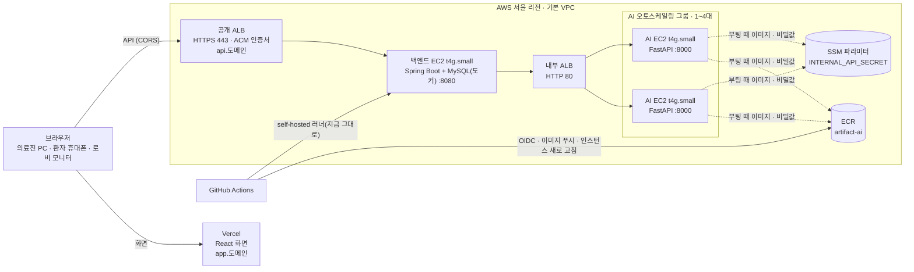

# AWS 실습 — ALB · AI 오토스케일링 · Vercel 로 나누기

> 지금까지는 EC2 한 대(`t4g.small`)에 화면·백엔드·AI·DB·HTTPS(Caddy)를 전부 올렸다. 이 문서는 그것을
> **화면은 Vercel, API 는 ALB 뒤 백엔드 EC2, AI 는 내부 ALB 뒤 오토스케일링 그룹**으로 나누는 실습 절차다.
> 콘솔에서 사람이 눌러야 하는 것을 순서대로 적었다. 코드 쪽 설명은 각 파일의 주석이 원본이다.
>
> 관련 파일: `docker-compose.elb.yml`(백엔드 EC2), `.github/workflows/deploy.yml`(`DEPLOY_TARGET`),
> `.github/workflows/deploy-ai.yml`(ECR · 인스턴스 새로 고침), `deploy/aws/ai-user-data.sh`(AI 인스턴스 시작 스크립트),
> `deploy/aws/iam/*.json`(IAM 정책 견본), `frontend/vercel.json`, `frontend/src/api/base.ts`(`VITE_API_BASE_URL`)

---

## 0. 한눈에 보기

### 구성



| 무엇 | 어디서 | 배포 |
|---|---|---|
| 화면(React) | Vercel | Git 연동 — main 에 머지하면 Vercel 이 빌드 |
| 백엔드 + MySQL | 지금 쓰는 EC2(그대로 백엔드 서버가 된다 — DB 볼륨 유지) | `deploy.yml` (self-hosted 러너, `DEPLOY_TARGET=elb`) |
| AI(FastAPI) | 오토스케일링 그룹의 EC2 들 | `deploy-ai.yml` (ECR 푸시 → 인스턴스 새로 고침) |
| HTTPS | 공개 ALB(ACM 인증서) | — |

### 순서와 원칙

1~8 단계는 **지금 사이트를 그대로 둔 채** 만든다. `DEPLOY_TARGET` 이 비어 있는 동안 배포는 지금까지와 같은 한 서버
구성으로 돈다 — 이 코드가 main 에 먼저 머지돼도 아무것도 바뀌지 않는다. 9 단계에서 변수 하나를 바꿔 넘어간다.

| 단계 | 하는 일 | 지금 사이트 |
|---|---|---|
| 1 | 도메인 · 이름 정하기 | 그대로 |
| 2 | 보안 그룹 4개 | 그대로 |
| 3 | IAM — AI 인스턴스 역할, GitHub OIDC 역할 | 그대로 |
| 4 | SSM 파라미터(내부 시크릿) | 그대로 |
| 5 | ECR + 첫 AI 이미지 | 그대로 |
| 6 | 내부 ALB + AI 오토스케일링 그룹 | 그대로 |
| 7 | 공개 ALB + ACM + api 도메인 | 그대로 |
| 8 | Vercel 화면 | 그대로 |
| **9** | **백엔드 .env → `DEPLOY_TARGET=elb` → 배포** | **여기서 넘어간다** |
| 10 | 오토스케일링 실습(부하 걸기) | — |
| 11~12 | 되돌리기 · 정리 | — |

### 비용 (서울 리전 온디맨드, 30일 기준 대략)

| 항목 | 개수 | 월 | 비고 |
|---|---:|---:|---|
| EC2 `t4g.small` ($0.0208/h) | 3 (백엔드 1 + AI 2) | 약 $45 | AI 가 4대로 늘면 그 시간만큼 더 |
| ALB (시간당 + LCU) | 2 (공개 1 + 내부 1) | 약 $35~40 | 끌 수 없다 — 안 쓰면 지운다 |
| 공인 IPv4 ($0.005/h) | 5 안팎 (공개 ALB 2 + EC2 3) | 약 $18 | 내부 ALB 는 공인 IP 가 없다 |
| EBS gp3 | 30 + 16×2 GB | 약 $6 | |
| ECR · Route 53 호스팅 영역 | | 약 $1 | 도메인 등록비 별도(.com 연 $15 안팎) |
| **합계** | | **약 $105/월 (하루 $3.5)** | 지금 한 서버 구성은 약 $22/월 |

- 실습 목적이면 **기간을 정해 두고 끝나면 12 단계로 지운다.** 그대로 두면 크레딧이 한 달 반 정도면 바닥난다.
  크레딧 잔액과 예산 알림은 `docs/booth-operation-guide.md` 1-1 의 화면 순서대로 먼저 확인한다.
- 값은 콘솔 요금표로 한 번 더 확인한다. 특히 ALB 는 트래픽(LCU)에 따라 조금 달라진다.
- vCPU 한도: `t4g.small` 은 2 vCPU 다. AI 가 최대 4대면 백엔드 포함 10 vCPU 가 필요하다. EC2 → 한도(Limits)에서
  "Running On-Demand Standard instances" 가 10 이상인지 본다(`docs/booth-operation-guide.md` 1-2).

---

## 1. 도메인 · 이름 정하기

**도메인이 필요하다.** ALB 에 HTTPS 를 붙이려면 ACM 인증서가 필요하고, ACM 은 도메인에 CNAME 레코드를 추가해
소유를 확인한다. 지금 쓰는 DuckDNS 는 CNAME 을 추가할 수 없어 쓸 수 없다.

- 가장 쉬운 길: **Route 53 → 도메인 등록**에서 사서 그대로 쓴다(호스팅 영역이 자동으로 생긴다).
- 다른 곳에서 샀다면 Route 53 에 호스팅 영역을 만들고, 등록 업체의 네임서버를 Route 53 의 4개로 바꾼다.

이 문서는 아래 이름을 쓴다. `<도메인>` 은 산 도메인(예: `artifact-emr.com`)이다.

| 이름 | 무엇 |
|---|---|
| `app.<도메인>` | 화면(Vercel) |
| `api.<도메인>` | API(공개 ALB) |
| `artifact-ai` | ECR 저장소 |
| `artifact-ai-tg` / `artifact-ai-alb` | AI 대상 그룹 / 내부 ALB |
| `artifact-ai-lt` / `artifact-ai-asg` | AI 시작 템플릿 / 오토스케일링 그룹 |
| `artifact-backend-tg` / `artifact-api-alb` | 백엔드 대상 그룹 / 공개 ALB |

리전은 전부 **아시아 태평양(서울) ap-northeast-2**. 화면 오른쪽 위에서 먼저 확인한다.

---

## 2. 보안 그룹 4개

요청이 지나가는 길을 그대로 막는다: 인터넷 → 공개 ALB → 백엔드 → 내부 ALB → AI. **각 단계는 바로 앞 단계의
보안 그룹에서 온 것만 받는다.** IP 가 아니라 보안 그룹을 소스로 적으므로 인스턴스가 늘고 줄어도 규칙을 고칠 일이 없다.

EC2 → 왼쪽 **보안 그룹** → **보안 그룹 생성**. VPC 는 지금 서버와 같은 것(기본 VPC). 아웃바운드는 기본값(전체 허용).

| 이름 | 인바운드 | 쓰는 곳 |
|---|---|---|
| `artifact-alb-public-sg` | HTTP 80 · HTTPS 443 / 소스 `0.0.0.0/0` (IPv6 쓰면 `::/0` 도) | 공개 ALB |
| `artifact-alb-ai-sg` | HTTP 80 / 소스 = 지금 서버의 보안 그룹(`artifact-sg`) | 내부 ALB |
| `artifact-ai-sg` | 사용자 지정 TCP 8000 / 소스 = `artifact-alb-ai-sg` | AI 인스턴스 |

지금 서버의 보안 그룹(`artifact-sg`)에는 규칙 하나를 **추가**한다(기존 규칙은 9 단계 뒤에 정리):

- 사용자 지정 TCP **8080** / 소스 = `artifact-alb-public-sg`

> ⚠️ 8000·8080 의 소스를 `0.0.0.0/0` 으로 두지 않는다. 시크릿 헤더·JWT 가 있어도 ALB 를 우회하는 입구를 남길 이유가 없다.

---

## 3. IAM — 키 대신 역할

이 구성에서는 **AWS 액세스 키를 어디에도 저장하지 않는다.** EC2 는 인스턴스 역할로, GitHub Actions 는 OIDC 로
그때그때 임시 자격 증명을 받는다. 정책 견본은 `deploy/aws/iam/` 에 있다 — 붙여 넣기 전에 `ACCOUNT_ID` 를
계정 ID(콘솔 오른쪽 위 계정 메뉴의 12자리)로 바꾼다.

### 3-1. AI 인스턴스 역할 `artifact-ai-instance-role`

1. IAM → **역할** → **역할 생성** → 신뢰할 수 있는 엔터티 **AWS 서비스** → 사용 사례 **EC2**
2. 권한: `AmazonSSMManagedInstanceCore` 체크(Session Manager 로 SSH 없이 접속하려고)
3. 이름 `artifact-ai-instance-role` → 생성
4. 만든 역할 → **권한 추가 → 인라인 정책 생성 → JSON** → `deploy/aws/iam/ai-instance-policy.json` 내용
   (ECR 에서 이미지 받기 + SSM 파라미터 하나 읽기) → 이름 `artifact-ai-pull-and-secret`

### 3-2. (S3 를 쓴다면) 백엔드 역할

이미지를 지금처럼 서버 디스크(`IMAGE_STORAGE_TYPE=local`)에 둔다면 건너뛴다.
S3 를 쓰면 역할 `artifact-backend-instance-role` 을 같은 방법(EC2, `AmazonSSMManagedInstanceCore`)으로 만들고 인라인 정책에
`deploy/aws/iam/backend-instance-s3-policy.json` (`BUCKET_NAME` 교체)을 넣는다. 지금 서버 → **작업 → 보안 → IAM 역할 수정**
으로 붙이고, 9 단계에서 `.env` 의 `AWS_ACCESS_KEY`·`AWS_SECRET_KEY` 를 비운다 — 키가 비어 있으면 백엔드가 역할로 S3 에
접근한다(`AwsConfig`).

### 3-3. GitHub Actions OIDC 역할 `artifact-github-deploy`

1. IAM → **자격 증명 공급자** → **공급자 추가** → **OpenID Connect**
   - 공급자 URL `https://token.actions.githubusercontent.com`, 대상 `sts.amazonaws.com` → 추가
2. IAM → **역할 생성** → **사용자 지정 신뢰 정책** → `deploy/aws/iam/github-actions-trust.json`
   - 이 저장소의 **main 브랜치**에서 돈 워크플로만 이 역할을 빌릴 수 있다. 포크·다른 브랜치의 PR 은 못 빌린다
3. 권한은 건너뛰고 이름 `artifact-github-deploy` 로 생성 → 만든 역할 → 인라인 정책 → `deploy/aws/iam/github-actions-policy.json`
   (ECR 푸시 + `artifact-ai-asg` 새로 고침)
4. 역할의 **ARN**(`arn:aws:iam::...:role/artifact-github-deploy`)을 적어 둔다

---

## 4. SSM 파라미터 — 내부 시크릿

백엔드와 AI 서버는 `INTERNAL_API_SECRET` 이 같아야 한다(다르면 모든 분석이 401). AI 인스턴스는 자동으로 생기고
사라지므로 값을 손으로 넣을 수 없다 — 부팅할 때 Parameter Store 에서 읽게 한다.

1. 지금 서버에 SSH 로 접속해 값을 확인한다(화면에 띄우기만 하고 채팅·문서에 붙이지 않는다):
   `grep ^INTERNAL_API_SECRET= ~/artifact/.env`
2. Systems Manager → **Parameter Store** → **파라미터 생성**
   - 이름 `/artifact/INTERNAL_API_SECRET`, 유형 **SecureString**(KMS 키는 기본 `alias/aws/ssm`), 값 = 위 값
3. 값을 바꿀 때는 이 파라미터와 백엔드 `.env` 를 함께 바꾸고, AI 그룹을 새로 고침한다(5-3 의 수동 실행)

---

## 5. ECR + 첫 AI 이미지

### 5-1. 저장소

ECR → **리포지토리 생성** → 프라이빗, 이름 `artifact-ai`. 만든 뒤 **수명 주기 정책** → 규칙 하나:
"이미지 개수 10개 초과 시 오래된 것 만료"(태그 상태: 모두). 배포마다 이미지가 쌓이므로 상한을 둔다.

### 5-2. 저장소 변수

GitHub 저장소 → **Settings → Secrets and variables → Actions → Variables** → **New repository variable**

| 이름 | 값 |
|---|---|
| `AWS_DEPLOY_ROLE_ARN` | 3-3 의 역할 ARN |
| `AI_ASG_NAME` | **아직 만들지 않는다**(6 단계 뒤) |

(`AWS_REGION` 기본 `ap-northeast-2`, `AI_ECR_REPOSITORY` 기본 `artifact-ai` — 이름을 바꿨을 때만 넣는다)

### 5-3. 첫 푸시

Actions → **Deploy AI** → **Run workflow** (Branch `main`). 하는 일:

1. arm64 러너(`ubuntu-24.04-arm`, 공개 저장소 무료)에서 `fastapi/` 이미지 빌드
2. 러너에서 컨테이너를 띄워 **`/health/ready` 가 200 인지**(병변·안면부 모델이 전부 로드됐는지) 확인 — 깨진 이미지는 올리지 않는다
3. ECR 에 `:<커밋>` 과 `:latest` 로 푸시
4. `AI_ASG_NAME` 이 비어 있으므로 새로 고침은 건너뛴다

ECR → `artifact-ai` 에 `latest` 가 보이면 된다(10~15분, 대부분 torch 설치).

> 이 워크플로는 `AWS_DEPLOY_ROLE_ARN` 이 없으면 아무것도 하지 않는다. 이후에는 `fastapi/` 가 바뀐 커밋이 main 에
> 들어올 때마다 저절로 돈다.

---

## 6. AI — 내부 ALB + 오토스케일링 그룹

### 6-1. 대상 그룹 `artifact-ai-tg`

EC2 → **대상 그룹** → **대상 그룹 생성**

- 대상 유형 **인스턴스**, 이름 `artifact-ai-tg`, 프로토콜 **HTTP**, 포트 **8000**, VPC 기본
- 상태 검사: 경로 **`/health/ready`**
  - 고급: 정상 임계값 2, 비정상 임계값 3, 제한 시간 5초, 간격 15초, 성공 코드 200
  - `/health` 가 아니라 `/health/ready` 인 이유: `/health` 는 기본 모델만 뜨면 200 이다. 안면부 가중치가 깨진 이미지도
    "정상"이 되어 새로 고침 때 모든 인스턴스로 퍼진다. `/health/ready` 는 모델이 전부 떠야 200 이다(`fastapi/main.py`)
- 대상 등록은 건너뛴다(오토스케일링 그룹이 넣고 뺀다) → 생성
- 만든 뒤 **속성 편집** → 등록 취소 지연(deregistration delay) **30초**. 기본 300초면 인스턴스를 뺄 때마다 5분을 기다린다.
  분석 요청은 30초 안에 끝난다

### 6-2. 내부 ALB `artifact-ai-alb`

EC2 → **로드 밸런서** → **Application Load Balancer** 생성

- 이름 `artifact-ai-alb`, 체계 **내부(Internal)**, IPv4
- VPC 기본, 매핑: 가용 영역 **2개 이상**(예: 2a, 2c)
- 보안 그룹: `artifact-alb-ai-sg` 만(default 는 빼기)
- 리스너: **HTTP 80** → 기본 작업 `artifact-ai-tg`
- 생성 뒤 **DNS 이름**(`internal-artifact-ai-alb-....ap-northeast-2.elb.amazonaws.com`)을 적어 둔다 — 9 단계의 `FASTAPI_URL`

### 6-3. 시작 템플릿 `artifact-ai-lt`

EC2 → **시작 템플릿** → **시작 템플릿 생성**

- 이름 `artifact-ai-lt`, "Auto Scaling 지침" 체크
- AMI: **Amazon Linux 2023**, 아키텍처 **64비트(Arm)**
- 인스턴스 유형 `t4g.small` (모델 두 개 + 스왑 2GB. 메모리가 모자라면 `t4g.medium`)
- 키 페어: 없음(접속은 Session Manager). 꼭 SSH 를 쓰려면 지금 키를 고른다
- 네트워크: 서브넷은 고르지 않는다(그룹이 고른다), 보안 그룹 `artifact-ai-sg`
  - 기본 VPC 의 서브넷은 공인 IP 를 자동으로 붙인다. 그래야 NAT 게이트웨이(월 $40 이상) 없이 ECR 에서 이미지를 받는다.
    인바운드는 보안 그룹이 내부 ALB 에서 온 8000 만 받으므로, 공인 IP 가 있어도 밖에서 들어올 수 없다
- 스토리지: **16 GiB gp3** (기본 8GB 는 도커 이미지 + 스왑에 모자라다)
- 고급 세부 정보
  - IAM 인스턴스 프로파일: `artifact-ai-instance-role`
  - 메타데이터 버전: **V2 전용(토큰 필수)** — 시작 스크립트가 IMDSv2 로 리전·계정을 읽는다
  - 사용자 데이터: `deploy/aws/ai-user-data.sh` 내용 전체를 붙여 넣는다(이름을 바꿨으면 맨 위 세 줄만 고친다)

### 6-4. 오토스케일링 그룹 `artifact-ai-asg`

EC2 → **Auto Scaling 그룹** → **생성**

1. 시작 템플릿 `artifact-ai-lt`, 버전 **Latest**
2. VPC 기본, 가용 영역 = 6-2 의 ALB 와 같은 영역들
3. 로드 밸런싱: **기존 로드 밸런서에 연결** → 대상 그룹 `artifact-ai-tg`
   - 상태 확인: **Elastic Load Balancing 상태 확인 켜기**, 유예 기간 **300초**
     (부팅 → 도커 설치 → 이미지 받기 → 모델 로드에 2~4분 걸린다. 그 전에 비정상으로 판정하면 끝없이 갈아 끼운다)
4. 그룹 크기: 원하는 용량 **2**, 최소 **1**, 최대 **4**
5. 크기 조정: **대상 추적 크기 조정 정책** → 지표 **평균 CPU 사용률**, 대상 값 **60**, 인스턴스 워밍업 300초
6. 생성 → 2~5분 뒤 `artifact-ai-tg` → **대상** 탭에 인스턴스 2개가 **healthy**

> 안 될 때: 대상이 unhealthy 로 반복 교체되면 인스턴스 하나를 골라 **연결 → Session Manager** →
> `sudo tail -50 /var/log/artifact-ai-user-data.log`. 흔한 원인은 역할 권한(ECR·SSM), 파라미터 이름 오타,
> 5 단계 이미지 없음이다. 컨테이너 로그는 `sudo docker logs --tail 50 artifact-ai`.

### 6-5. 백엔드 서버에서 닿는지 확인

지금 서버에 SSH 로 접속해서:

```bash
curl -s http://<6-2 의 DNS 이름>/health/ready
# {"status":"ready","tasks":["facial","skin_lesion"]} 이면 된다
```

`artifact-alb-ai-sg` 가 지금 서버의 보안 그룹만 받으므로, 이 서버에서만 닿고 인터넷에서는 닿지 않는다.

### 6-6. 자동 롤링 배포 켜기

저장소 변수 `AI_ASG_NAME` = `artifact-ai-asg` 추가. 이제 `fastapi/` 가 바뀌면 Deploy AI 가 이미지를 올린 뒤
**인스턴스 새로 고침**을 시작한다. 2대면 한 대씩(최소 정상 50%) 새 인스턴스로 바꾸고, 새 인스턴스가 `/health/ready` 를
통과하지 못하면 새로 고침이 실패로 끝나 옛 인스턴스가 그대로 일한다.

---

## 7. 백엔드 앞에 공개 ALB

### 7-1. 인증서 (ACM)

Certificate Manager(**서울 리전** — ALB 와 같은 리전이어야 한다) → **인증서 요청** → 퍼블릭 →
도메인 `api.<도메인>` → DNS 검증 → 요청. 인증서 화면의 **Route 53 에서 레코드 생성** → 몇 분 뒤 **발급됨**.

### 7-2. 대상 그룹 `artifact-backend-tg`

- 인스턴스, HTTP **8080**, VPC 기본
- 상태 검사 경로 **`/api/health`**(로그인 없이 `{"status":"UP"}` — `HealthController`), 성공 코드 200, 간격 15초
- 대상 등록: **지금 서버**를 포트 8080 으로 포함 → 생성 → 등록 취소 지연 30초
- 지금은 **unhealthy 가 정상**이다. 한 서버 구성에서는 백엔드 8080 을 호스트에 열지 않는다. 9 단계 뒤 healthy 가 된다

### 7-3. 공개 ALB `artifact-api-alb`

- 이름 `artifact-api-alb`, 체계 **인터넷 경계(Internet-facing)**, IPv4
- 가용 영역 2개 이상 — **지금 서버가 있는 영역을 반드시 포함**(인스턴스 세부 정보의 가용 영역)
- 보안 그룹 `artifact-alb-public-sg`
- 리스너
  - **HTTPS 443** → `artifact-backend-tg`, 인증서 7-1, 보안 정책은 기본값(TLS 1.3 포함)
  - **HTTP 80** → 작업 **URL로 리디렉션** → HTTPS 443, 301
- 유휴 제한 시간은 기본 60초 그대로(LLM 대체 사슬이 30초 안에 끝난다 — README "AI 처방 코멘트")

### 7-4. api 도메인 연결

Route 53 → 호스팅 영역 → **레코드 생성** → 이름 `api`, 유형 A, **별칭** 켜기 → Application/Classic Load Balancer →
서울 → `artifact-api-alb`. 1~2분 뒤 `https://api.<도메인>/api/health` 는 아직 503 이다(대상이 unhealthy — 9 단계 전이라 정상).

---

## 8. Vercel — 화면

1. vercel.com 에 GitHub 로 로그인 → **Add New → Project** → 이 저장소 **Import**
2. **Root Directory** = `frontend` (빌드 설정은 `frontend/vercel.json` 이 정한다: Vite, `npm run build`, `dist`,
   모든 경로를 `index.html` 로 — `/main/clinic`, `/kiosk/<토큰>` 같은 주소를 새로 고쳐도 열린다)
3. **Environment Variables**: `VITE_API_BASE_URL` = `https://api.<도메인>` (끝에 `/` 없이)
   - 화면은 이 값으로 API 를 직접 부른다(`frontend/src/api/base.ts`). **빌드할 때 굳는다** — 바꾸면 다시 배포해야 반영된다
4. **Deploy** → 끝나면 프로젝트 → **Settings → Domains** → `app.<도메인>` 추가 → Vercel 이 알려 주는 레코드(보통 CNAME
   `cname.vercel-dns.com`)를 Route 53 에 만든다
5. 이후 main 에 머지하면 Vercel 이 알아서 다시 빌드한다. PR 마다 미리보기 주소도 생긴다
   - 미리보기 주소(`*.vercel.app`)는 9 단계의 CORS 목록에 없어 API 가 막힌다. 미리보기에서도 로그인하려면
     `CORS_ALLOWED_ORIGINS` 에 패턴을 더한다(예: `https://artifact-*-<팀이름>.vercel.app`)

이 시점에 `https://app.<도메인>` 은 열리지만 로그인은 아직 안 된다(API 가 9 단계 전).
로그인 화면의 **로그인 없이 데모 체험하기**는 브라우저 안에서만 돌아 지금도 된다(`docs/demo-mode.md`).

---

## 9. 넘어가기 (cut-over)

**접수가 없는 시간에 한다.** 9-3 의 배포가 도는 1~3분 동안 사이트가 멈춘다.

### 9-1. 백엔드 `.env`

지금 서버에 SSH 로 접속해 `~/artifact/.env` 에 추가한다(`.env.production.example` 맨 아래 절 참고):

```bash
FASTAPI_URL=http://<6-2 의 DNS 이름>
CORS_ALLOWED_ORIGINS=https://app.<도메인>
PRINT_KIOSK_ALLOWED_BASE_URLS=https://app.<도메인>
# 텔레그램 알림을 켜 두었다면
TELEGRAM_PUBLIC_BASE_URL=https://app.<도메인>
# 3-2 의 역할을 붙였다면 두 키를 비운다
AWS_ACCESS_KEY=
AWS_SECRET_KEY=
```

> ⚠️ 위 값을 넣은 뒤 9-3 전에 다른 배포가 돌면, 한 서버 구성의 화면(duckdns)이 CORS 로 막힌다. 미리 넣어 둘 거라면
> 두 값에 지금 주소도 쉼표로 같이 적는다: `https://artifact-prod.duckdns.org,https://app.<도메인>`

### 9-2. 저장소 변수

| 이름 | 값 |
|---|---|
| `DEPLOY_TARGET` | `elb` |
| `API_URL` | `https://api.<도메인>` |

### 9-3. 배포

Actions → **Deploy** → **Run workflow** (main). 로그에서 확인할 것:

- "ELB 구성으로 배포 (DEPLOY_TARGET=elb) — 이 서버는 MySQL + 백엔드만"
- 화면·AI·Caddy 컨테이너(`artifact-frontend`·`artifact-fastapi`·`artifact-caddy`)가 지워지고 `artifact-mysql`·`artifact-backend` 만 남는다
- 헬스체크가 `https://api.<도메인>/api/health` 와 로그인 요청(4xx)을 **ALB 를 거쳐** 받는다 → ✅

`.env` 의 세 값 중 하나라도 비면 compose 가 기동 전에 멈추고 무엇이 빠졌는지 적는다.

### 9-4. 확인

- `artifact-backend-tg` → 대상 **healthy**
- `https://app.<도메인>` 로그인 → 접수 → 접수증 QR 이 `https://app.<도메인>/kiosk/...` 인지
- 키오스크(휴대폰)로 사진 분석 → 진료실 AI 분석 → 처방 → 증명서 → 대기 현황판
- AI 요청이 두 인스턴스로 나뉘는지: EC2 → 대상 그룹 `artifact-ai-tg` → **모니터링**의 요청 수, 또는 각 인스턴스의
  `sudo docker logs --tail 5 artifact-ai`

### 9-5. 정리

- 지금 서버 보안 그룹(`artifact-sg`)에서 **80·443 인바운드 삭제**(Caddy 가 없다). 22 는 내 IP 로만 두거나,
  Session Manager 를 쓰려면 서버에 `AmazonSSMManagedInstanceCore` 가 든 역할을 붙이고 지운다
- DuckDNS 주소는 더 이상 열리지 않는다. 남겨 둔 인쇄물 QR(옛 주소)도 열리지 않는다
- 부스 때 접수 데스크 맥에서 돌던 print-agent 를 다시 쓴다면 그 `.env` 의 `BACKEND_URL` 을 `https://api.<도메인>`,
  `KIOSK_BASE_URL` 을 `https://app.<도메인>` 으로 바꾼다(`print-agent/config.py`)

---

## 10. 오토스케일링 실습 — 부하를 걸어 늘고 줄어드는 것 보기

`scripts/booth/kiosk_load_check.py` 는 키오스크 여러 대가 동시에 분석하는 상황을 만든다. API 주소만 있으면 된다.
접수를 만들었다가 끝나면 취소한다(접수증 출력 작업이 생기지만 print-agent 가 없으면 2분 뒤 버려진다).

```bash
export BOOTH_LOGIN_ID=<관리자 아이디> BOOTH_PASSWORD='<비밀번호>'   # 셸 기록에 남지 않게 환경변수로
python3 scripts/booth/kiosk_load_check.py --base-url https://api.<도메인> \
    --images <사진 폴더(서로 다른 사진 6장 이상)> --devices 6 --rounds 40 --task skin_lesion
```

보는 곳:

1. EC2 → Auto Scaling 그룹 → `artifact-ai-asg` → **모니터링**: 평균 CPU 가 60% 를 몇 분 넘으면
2. **활동** 탭에 "Launching a new EC2 instance" — 원하는 용량이 3, 4 로 늘어난다(최대 4)
3. 새 인스턴스는 대상 그룹에서 initial → healthy 가 된 뒤에야 요청을 받는다(2~4분 — 시작 스크립트 + 모델 로드)
4. 부하를 멈추고 15분쯤 지나면 축소 알람으로 다시 2 로 줄어든다(최소 1, 원하는 용량은 정책이 정한다)
5. CloudWatch → **경보**에서 대상 추적 정책이 만든 `TargetTracking-artifact-ai-asg-AlarmHigh/Low` 를 볼 수 있다

해 볼 만한 것:

- 인스턴스 하나를 콘솔에서 **종료** → 그룹이 알아서 새로 띄워 원하는 용량을 맞춘다(자가 치유)
- `fastapi/` 를 조금 고쳐 머지 → Deploy AI 의 인스턴스 새로 고침이 한 대씩 갈아 끼우는 동안 분석이 끊기지 않는지
- 원하는 용량을 0 으로 → 진료실 AI 분석이 "AI 서버" 오류를 내는지(백엔드는 503 을 받는다) → 다시 2 로

> `t4g` 는 버스트형이다. 계속 100% 로 돌리면 CPU 크레딧을 다 쓰고, 기본 "무제한" 모드에서는 초과분이 조금 과금된다.
> 실습은 10~20분 단위로 끊는다.

---

## 11. 되돌리기

### 한 서버 구성으로

1. 지금 서버 보안 그룹에 80·443 인바운드를 다시 연다, DuckDNS 의 IP 가 이 서버인지 확인한다
2. 저장소 변수 `DEPLOY_TARGET` 을 지운다(또는 빈 값)
3. Actions → **Deploy** → Run workflow — 화면·AI·Caddy 가 이 서버에 다시 뜬다
   - `.env` 의 `CORS_ALLOWED_ORIGINS`·`PRINT_KIOSK_ALLOWED_BASE_URLS` 를 지우거나 `https://artifact-prod.duckdns.org` 로
     되돌린다(남겨 두면 duckdns 화면의 로그인이 CORS 로 막힌다)

### AI 이미지만 이전 것으로

ECR 에는 커밋별 태그가 남아 있다. 되돌릴 커밋 `<sha>` 의 이미지를 `latest` 로 다시 붙이고 새로 고침한다:

```bash
MANIFEST=$(aws ecr batch-get-image --repository-name artifact-ai --image-ids imageTag=<sha> \
             --query 'images[0].imageManifest' --output text)
aws ecr put-image --repository-name artifact-ai --image-tag latest --image-manifest "$MANIFEST"
aws autoscaling start-instance-refresh --auto-scaling-group-name artifact-ai-asg \
  --preferences '{"MinHealthyPercentage":50,"InstanceWarmup":120}'
```

---

## 12. 정리 — 실습이 끝나면 (요금 멈추기)

지우는 순서가 있다(앞의 것이 뒤의 것을 붙잡고 있다):

1. 11 단계로 한 서버 구성에 돌아간다(서비스를 계속 쓸 거라면)
2. Auto Scaling 그룹 `artifact-ai-asg` 삭제 — 인스턴스가 함께 종료된다
3. 로드 밸런서 `artifact-ai-alb`, `artifact-api-alb` 삭제 → 대상 그룹 두 개 삭제
4. 시작 템플릿 `artifact-ai-lt` 삭제(요금은 없지만 정리)
5. 보안 그룹 `artifact-ai-sg`·`artifact-alb-ai-sg`·`artifact-alb-public-sg` 삭제, `artifact-sg` 에서 8080 규칙 삭제
6. ECR `artifact-ai` 이미지(또는 저장소) 삭제 — 저장 용량만큼 과금
7. 저장소 변수 `AI_ASG_NAME` 삭제(남겨 두면 Deploy AI 가 없는 그룹을 새로 고치려다 실패한다).
   `AWS_DEPLOY_ROLE_ARN` 까지 지우면 Deploy AI 가 아예 돌지 않는다
8. Route 53 호스팅 영역은 도메인을 계속 쓸 거면 둔다(월 $0.50). Vercel 무료 플랜은 그대로 둬도 된다
9. 며칠 뒤 결제 및 비용 관리 → **청구서**에서 ELB·EC2 항목이 더 늘지 않는지 본다

---

## 13. 자주 막히는 곳

| 증상 | 원인 | 할 일 |
|---|---|---|
| Vercel 화면은 뜨는데 로그인하면 "서버에 연결할 수 없습니다" | `VITE_API_BASE_URL` 이 없거나 틀림, 또는 api 도메인·ALB 문제 | 브라우저 개발자 도구 → 네트워크에서 로그인 요청 주소가 `https://api.<도메인>/api/...` 인지. 아니면 Vercel 환경변수를 고치고 **다시 배포** |
| 콘솔에 `CORS policy` 오류, 응답 403 `Invalid CORS request` | 백엔드 `CORS_ALLOWED_ORIGINS` 에 화면 주소가 정확히 없음(스킴·호스트, 끝 `/` 없이) | `.env` 를 고치고 Deploy 를 다시 돌린다(컨테이너를 새 값으로 다시 만든다) |
| `api.<도메인>` 이 503 | 백엔드 대상 그룹에 healthy 대상이 없다 | 서버에서 `curl localhost:8080/api/health`. 200 이면 보안 그룹(8080 ← `artifact-alb-public-sg`)·대상 등록 포트, 아니면 `docker logs artifact-backend` |
| AI 분석만 실패(502/503, "AI 서버") | 내부 ALB 뒤에 healthy AI 가 없다 | 6-4 "안 될 때". 백엔드 로그에 401 이면 SSM 파라미터와 `.env` 의 `INTERNAL_API_SECRET` 이 다르다 |
| 인스턴스가 계속 새로 생겼다 사라진다 | 유예 기간 안에 `/health/ready` 를 통과하지 못함 | 시작 스크립트 로그. 메모리 부족(OOM)이면 `t4g.medium` 으로 시작 템플릿 새 버전 → 새로 고침 |
| Deploy AI 의 새로 고침이 실패 | 새 이미지의 모델이 전부 뜨지 않음(`/health/ready` 503) | 실패해도 옛 인스턴스가 남아 서비스는 그대로다. 대상 그룹의 비정상 사유와 인스턴스 로그로 원인을 고쳐 다시 머지 |
| Deploy AI 가 `Not authorized to perform sts:AssumeRoleWithWebIdentity` | 신뢰 정책의 저장소·브랜치가 다름, 또는 OIDC 공급자 없음 | 3-3. main 이 아닌 브랜치에서 수동 실행해도 이 오류다 |
| 접수증 QR 이 옛 주소 | `PRINT_KIOSK_ALLOWED_BASE_URLS`, 또는 접수 화면에 저장해 둔 키오스크 주소 | `.env` 확인. 접수 화면의 키오스크 주소 칸을 비우면 화면 주소(`app.<도메인>`)를 쓴다 |
